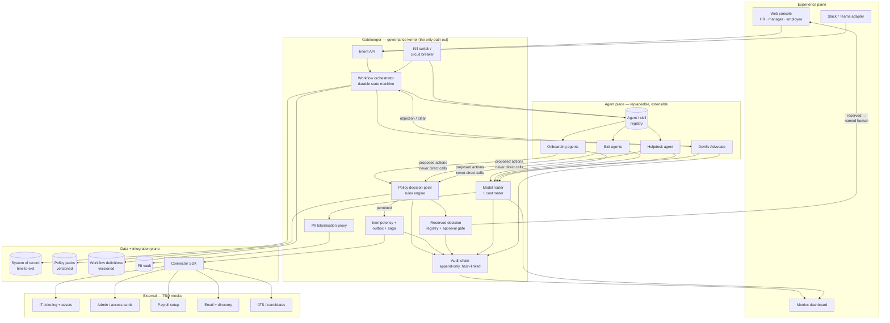
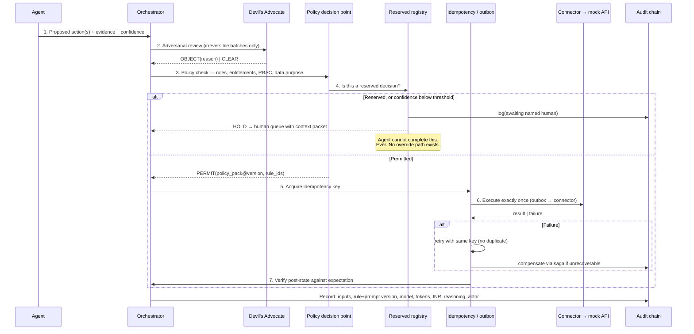
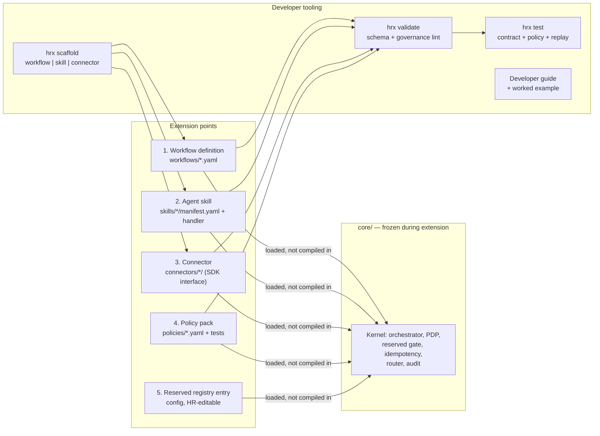
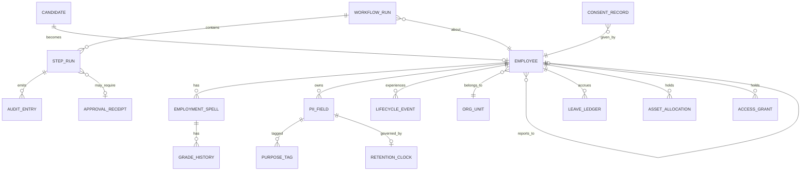

# HR Autopilot — Design Document

**Hackathon:** Building Software Faster — Challenge 2: an AI-native HR platform (TBO)
**Working name:** HR Autopilot (the bridge that closes the loop)
**Governance kernel:** Gatekeeper · **Challenge layer:** Devil's Advocate
**Status:** Round 1 design · v0.1 · 18 Nov 2026

> Names are placeholders. Swap them if the team prefers plain English — nothing in the architecture depends on them.

---

## As built — updated 20 Nov 2026

This document is the design. What follows is what the repository actually does today, checked against the master story (§4.3), so nobody presents a beat that does not exist. Live at `https://setu.139-84-220-87.sslip.io` (see DEPLOY.md).

### How it works, end to end

1. **Something starts a workflow** — a console button, a chat message ("I want to resign"), or a demo-story beat. Chat goes through one intent API; intents are matched by rules (`policies/intents.v2.yaml`), not a model; questions about the person's own record (name, manager, joining status) are answered from the record with no model.
2. **The orchestrator** (`core/orchestrator.py`) loads the workflow YAML and walks its steps in dependency order, saving every step's state in SQLite, so a crash resumes without repeating work.
3. **Each step is one of four kinds.** *Skill*: an agent function — deterministic ones only evaluate policy packs; model ones go through the PII proxy and the router. *Connector*: a side effect in another system. *Reserved*: a decision only a named human can make. *Route-only*: POSH / grievance / whistleblower, handed off untouched.
4. **Every side effect walks the governed path**: kill switch → Devil's Advocate gate A (irreversible actions) → authorisation (reserved verbs, RBAC ∩ capability ∩ step scope, DPDP purpose) → outbox → connector with the same idempotency key on every retry → read-back verification → audit entry with ₹.
5. **Humans decide in the Decisions inbox.** Each item is a context packet with one question; approving binds to a hash of the packet and produces a receipt. Agents attempting a decision get 403.
6. **Everything is measured** from the same database: ₹ per run, automation, escalations, refusals, Devil's Advocate precision — the Overview page and `make bench`.

### Story coverage (§4.3)

| Beat | Status | Notes |
|---|---|---|
| ICP pack with prohibited criteria | **Built** | `policies/icp.senior_platform_engineer.v2.yaml`; rules reading a prohibited field fail to load |
| Patent / OSS signals → pointers | **Built** | Synthetic signals only (`tools/seed_fairhire.py`) |
| Kavya stored as a pointer, model call refused | **Built** | Talent → *Ask the model about them* |
| Restricted employer blocked with clause ID | **Built** | `policies/no_raid.v1.yaml` |
| Campaign approval reserved; notice-first sends; objection ⇒ suppress + delete; interest ⇒ consent + upgrade | **Built** | Replies are simulated from the Talent page; mail is captured by a mock, never sent |
| Deterministic scoring with evidence spans; invented claim discarded | **Built** | |
| College-tier flag (gate D) | **Built** | Shown as a hearing on Talent |
| Auto-rejection refused (403) | **Built** | |
| Hiring decision + offer approval with receipts (Wednesday) | **Not built as a workflow** | The reserved actions exist in the registry and receipts work everywhere; there is no offer workflow |
| Meera's onboarding, entitlements by rule | **Built** | |
| Duplicate-laptop objection, verified by read-back | **Built** | |
| Tokenised payroll payload + payload viewer | **Built** | Personal data page |
| IT outage, retries, breaker, exactly one laptop | **Built** | Guardrails → *Break a TBO system*; chaos tests |
| Helpdesk answer citing the clause | **Built** | Chat |
| Tier 1 → tier 2 escalation, logged | **Built** | Measured trigger; seen live on Groq (gpt-oss-20b → 120b) |
| Faint ID scan → human with context packet | **Built** | |
| Policy edit blocked by gate B, test proposed | **Built** | Policy packs → *Draft a change* |
| Broken rule fails compliance CI | **Built** | GitHub Actions runs every pack's tests |
| Policy simulator: replay open exits under v5 | **Not built** | §16.2 |
| Exit prepared, not accepted; buyout reserved | **Built** | |
| Card revocation rescheduled after buyout (date_ordering) | **Built** | |
| Gratuity by rule while the model's prose is wrong | **Built (simulator)** | The wrong prose is scripted in the simulator; with Groq the model writes what it writes and the rule still decides |
| Retention clocks + statutory hold; access request | **Built** | |
| Grievance line → route and stop | **Built** | |
| Leave workflow self-pauses (circuit breaker) | **Built** | Breaker is tested; not a demo-story button |
| Nikhil's cold extension with `hrx` | **Built** | Rehearsed twice: leave encashment, probation confirmation |
| Dashboard, drillable | **Built** | |
| Provider swap, suite green | **Built** | sim / sim_alt / Groq; the key is entered on the website |
| Slack / Teams approvals | **Partial** | A Slack-style chat page over the intent API; no real Slack or Teams adapter |
| Agent self-chasing at the SLA (onboarding day −7) | **Not built** | |
| Shadow mode for new agents (§16.3) | **Not built** | |
| Consent withdrawal mid-workflow (§8) | **Not built** | Consent is recorded; no withdrawal flow |
| Routing-threshold calibration curve (§11.2) | **Not built** | Needs many real-model runs |

### Where the build differs from the design

- **State machine on SQLite, not Temporal/Postgres** (PROGRESS.md D14) — zero-setup and resumable; the schema ports to Postgres.
- **Models:** an offline simulator by default; Groq (`openai/gpt-oss-20b`, escalating to `-120b`, Apache-2.0) when a key is added on the website. Rupee figures use a declared rate card.
- **TBO's mock APIs were not available**; `mocks/tbo.py` stands in, deliberately not idempotent.
- **Devil's Advocate's model layer** reviews the plan once per run (it measured 46% of run cost when run on every step). On the simulator it adds nothing over the rules (88% catch, 0 false alarms on the fault corpus); on Groq it raised a real objection — re-measure before claiming a number.
- **Exit and FairHire needed kernel changes first** (fan-out steps, our own record as a connector, sourced-person records), made in separate `core:` commits before the lines; the lines themselves touch no `core/` file.
- **20 Nov: further kernel changes** — a *system down* notice to the human queue (the design's §-fail-safely intent, which the build had only half met: work was held safely but nobody was told), plain-language messages, and record-backed chat answers. The last of these should become an extension point; until then, a new kind of chat answer is a `core/` change.
- **What is editable on screen:** policy packs and the reserved list (validated, versioned, hot-reloaded). **Workflows are YAML files** — a developer edits them and runs `hrx validate`; there is no workflow editor in the console.
- **Hiring on a real model** needed `icp@v3`: places arrive as written ("Bengaluru"), so the place-to-region mapping is now a table in the pack rather than something the simulator quietly did.

## 0. How to read this document

| Section | For |
|---|---|
| 1–4 | The judge's mental model: what we chose, why, and what it feels like to use. **§4.3 is the master story — every feature in one narrative, with a coverage map** |
| 5–9 | The architecture that earns the 40% on governance + extensibility. **§9.5 is the talent-intelligence module (ICP scoring, consent-first sourcing, the no-raid guard)** |
| 10 | Devil's Advocate — our differentiator |
| 11–15 | Cost, failure handling, data, surfaces, metrics |
| 16–18 | Creative add-ons, stack, repo |
| 19–23 | Round plan, risks, traceability, assumptions |

**Round 1 submits a 6-page extract of this file**, not this file. Section 19 maps which parts go into those 6 pages.

---

## 1. The brief, compressed

TBO wants an **agent-first HR services platform** that could replace a conventional HRMS. Today an HRMS *records* events while people still *move* the work: a new hire is added, then HR emails IT for a laptop, Admin for an access card, Finance for payroll setup — and then chases all three.

Eight objectives, all of which must be visible in the submission:

1. **Automate end to end** — agents close cross-team loops (IT, Admin, Finance, hiring manager) with no manual email. Report the share of steps finishing with no human touch.
2. **Build a platform, not a point solution** — a TBO developer adds a new service line, agent, workflow or integration *without changing the core*. Documented extension model: workflow definitions, an agent/skill registry, API-first integrations.
3. **Keep humans on the decisions that matter** — reserved decisions route to a named approver and cannot be completed by an agent. The reserved list is **configuration HR can change**, not hard-coded logic.
4. **Comply by design** — legal and policy rules live in a governed layer that is versioned, testable and auditable, not buried in prompts.
5. **Keep a clean system of record** — hire-to-exit lifecycle, sound data model, RBAC, full audit trail of every change and who or what made it.
6. **Fail safely** — unsure agent, system down or conflicting data ⇒ human queue with context attached. Retries must never duplicate actions (no two laptops).
7. **Serve people where they work** — conversational interface (web, Teams or Slack), not forms only.
8. **Prove cost and impact with numbers** — cost per completed workflow, automation rate, cycle time, escalation rate on a simple dashboard.

**Non-negotiable guardrails.** Automation stops at decisions with legal, financial or human consequences. A submission that lets an agent complete any of these **is disqualified from the top scores**:

- Accepting a resignation; agreeing a release date or notice-period buyout
- Final hiring decisions, offer approval, compensation
- Termination, disciplinary action, performance improvement plans
- Salary, grade or role changes; any exception to policy
- Anything involving POSH, grievance or whistleblower complaints — **route only, never decide**
- Sign-off on statutory filings and payroll runs

**Must be designed in:** DPDP Act 2023 + Rules compliance (purpose limitation, consent, retention limits, access/correction requests); PII handling with an explicit account of what personal data reaches a model and where it is hosted, masked or minimised before any external model call; fair hiring (no automated rejection without human review, and an explanation of every ranking); explainability (every action records inputs, rule/prompt version, model used, reasoning); RBAC so an agent can never do more than the person it acts for; an instant kill switch with no code change; labour law encoded as rules (notice periods, final settlement timelines, EPF, gratuity, leave).

**Cost and model rule.** Any vendor, but judged on measured cost per completed workflow. HR services is not a frontier problem — routing routine work to a large frontier model scores poorly. Measure from real runs on the synthetic dataset and project a monthly run cost at TBO's volumes. Rule-based steps (eligibility, date maths, routing) belong in code; using an LLM where a rule would do counts against us. Small or open-weight models handle the default path; a larger model only when a *measured* confidence or complexity threshold calls for it, and we must justify that threshold. Changing provider must be configuration, not a rewrite. Count hosting, GPU and inference-provider cost — a self-hosted model is not free.

**TBO provides** (same starter kit for every team; demo must run on these interfaces): a synthetic HR dataset (fictional employees, org chart, candidates, leave balances, exits), mock IT and Admin APIs (ticketing, asset/laptop allocation, access cards, email and directory, payroll setup), and sample HR policies (onboarding, leave, notice period, exit, final settlement).

**Rounds.** (1) Concept and architecture — ≤6-page architecture document + 5-minute video; shortlisted on soundness of design, governance and cost logic. (2) Build — working demo on synthetic data, repo with README and setup steps, measured cost and automation figures, developer guide for adding a workflow; finalists chosen on working software and measured results. (3) Finale — live demo and Q&A with the TBO panel, plus a **live extension test: the panel gives a new HR requirement on the day and we add it to the platform within a set time.**

**Weights.**

| Criterion | Weight |
|---|---|
| Governance and compliance | 20% |
| Extensibility and architecture | 20% |
| Automation depth | 20% |
| Cost efficiency | 15% |
| Engineering quality | 15% |
| Experience and demo | 10% |

**Rules.** Synthetic data only, never real personal data. Every library and model must have a commercial-use licence, listed in the README. AI coding assistants allowed — say which and for what. Clean commit history; finalists are questioned individually about the parts they built.

### What the weights actually tell us

Governance + extensibility = **40%**, equal to automation + cost combined. The brief says it outright: a clever demo an HR team could not safely run, or TBO developers could not extend, will not win. And the live extension test is the hardest proof of objective 2 — *"if adding a workflow means rewriting your core, it will show."*

So the build order is **kernel-first, demo-second**. Most teams will build a beautiful onboarding demo and bolt governance on at the end. We invert it.

---

## 2. The decision: which service line, and why

Depth on one line beats shallow coverage of many. The candidates:

| Line | Cross-team loops | Governance richness | Mock-API fit | Verdict |
|---|---|---|---|---|
| Talent acquisition / sourcing | Medium | **Highest external risk**: fair hiring, DPDP lawful basis for non-applicants, TBO's own non-solicit obligations | Partial (ATS mock) | **Third line, built as the extensibility proof — §9.5** |
| **Onboarding (offer accepted → day 30)** | **Highest — IT, Admin, Finance, manager** | Medium | **Exact fit: ticketing, asset, access card, email/directory, payroll setup** | **Primary depth line** |
| Leave | Low | Medium (leave rules, EPF-adjacent) | Partial | Extension-test rehearsal |
| Employee helpdesk | Low | Low | Partial | Conversational surface, not a line |
| **Exit (resignation → final settlement)** | **High — mirror image of onboarding** | **Highest: reserved decisions, notice period, EPF, gratuity, F&F timelines, DPDP retention** | Same APIs in reverse | **Second line, built to prove extensibility** |

**Our choice: go deep on Onboarding, then ship Exit as the second line using only the published extension points — no core changes.**

Why this specific pair:

- **Onboarding is the brief's own example.** The laptop/access-card/payroll chase is the pain the problem statement names. The mock APIs TBO hands out are exactly an onboarding toolkit. Building here means our automation-depth number comes from the loop judges already have in their heads.
- **Exit is the governance showcase.** Accepting a resignation is reserved. Notice-period buyout is reserved. Payroll sign-off is reserved. Final settlement has statutory timelines, EPF and gratuity maths. DPDP retention limits bite the moment someone leaves. Everything the 20% governance criterion asks about is naturally present.
- **Exit is the mirror of onboarding, so it proves the platform claim honestly.** Onboarding *provisions* (allocate laptop, issue card, create email, set up payroll); exit *deprovisions* (recover laptop, revoke card, suspend email, run final settlement). Same connectors, opposite direction. If our extension model is real, the second line is almost entirely declarative — new workflow YAML, new policy pack, reuse of every existing connector and agent skill. **That is a dress rehearsal for the live extension test, run in advance, in public, in the repo.**

**What we tell the panel:** "We built one platform and two service lines. The second one took *N* hours and touched zero files in `core/`. Here is the commit range. Now give us your third."

That sentence is worth more than any demo polish.

---

## 3. What we're building

**HR Autopilot** is an agent-first HR services platform. Agents run the routine work end to end; a governance kernel sits between every agent intention and every real-world action; humans own the decisions that carry legal, financial or human weight; and every step is priced, logged and replayable.

### One-line pitch

> An HR platform where the agents do the chasing, the kernel enforces the law, and you can prove what every workflow cost and who decided what.

### In scope (Rounds 1–3)

| Area | What ships |
|---|---|
| Service line A — Onboarding | Offer accepted → day 30, fully instrumented, cross-team loops closed |
| Service line B — Exit | Resignation → final settlement, built via extension points only |
| Service line C — Talent intelligence (FairHire) | ICP scoring + consent-first sourcing + governed outreach. A **differently-shaped** line (external data, outbound comms, no employee record yet) built to prove the extension model survives a shape it was not designed for — §9.5 |
| Governance kernel (Gatekeeper) | Policy-as-configuration, reserved-decision registry, approval receipts, audit chain, kill switch, RBAC |
| Devil's Advocate | Adversarial review at three gates: pre-commit, policy change, extension time |
| Extension model | Workflow definitions, agent/skill registry, connector SDK, policy packs, CLI scaffolder, contract tests |
| Model router + cost meter | Tiered routing, per-step metering in INR, per-workflow budget guardrail |
| Safe failure | Idempotency keys, outbox, saga compensation, human queue with context packets, replay |
| Surfaces | Web console (HR, manager, employee) + Slack/Teams adapter over one intent API |
| Dashboard | Cost per workflow, automation rate, cycle time, escalation rate, policy-block rate, DA catch rate |
| Compliance | DPDP purpose tags, retention timers, DSR endpoints, PII tokenisation proxy, fair-hiring explanations |

### Out of scope, said out loud

| Not building | Why |
|---|---|
| Real IdP integration | Demo login; SSO is a connector, documented not built (see §23) |
| Payroll engine | We call the mock payroll API; we do not compute salaries |
| Mobile apps | Slack/Teams is where people already are |
| Multi-tenant isolation | Single-tenant TBO org for the hackathon; design notes only |
| Fine-tuned models | Routing + prompt versioning gets us there cheaper; fine-tuning is future work |
| Real ATS/HRMS migration | Importer sketch only |

### Design principles (we will be held to these)

1. **Deterministic by default.** If a rule can decide it, a rule decides it. An LLM call must justify its existence.
2. **The kernel is the only path to the outside world.** No agent calls a connector directly. Ever.
3. **Policy is data, not code, not prompt.** Versioned, diffable, testable, hot-swappable.
4. **Every action is idempotent or it does not ship.**
5. **Nothing happens that cannot be explained from the log alone** — without asking a model to reconstruct it.
6. **Extension points are the product.** The two service lines are demonstrations of them.
7. **Cost is a first-class SLO**, not a post-hoc report.

---

## 4. The story

Two walkthroughs. These become the 5-minute video and the live demo script.

### 4.1 Meera joins (onboarding — the happy path, mostly)

Meera Iyer accepts an offer as Senior Analyst, Gurgaon, joining in 11 days. Her offer was approved by a human — that gate is already behind us, and the receipt is in the log.

| # | What happens | Who does it | Cost tier |
|---|---|---|---|
| 1 | Offer-accepted event lands from the ATS mock | Connector | Tier 0 (code) |
| 2 | Employee record created; purpose tags and retention clock attached to every PII field | Kernel | Tier 0 |
| 3 | Onboarding plan instantiated from `workflows/onboarding.v3.yaml` — 24 steps, 3 of them reserved | Kernel | Tier 0 |
| 4 | Role→entitlement resolution: laptop class, software list, access zones, payroll band | Rules engine | Tier 0 |
| 5 | **Devil's Advocate gate A**: plan reviewed before any irreversible action. Objection raised — "an asset is already allocated to this candidate ID from a prior contract stint; allocating again risks a duplicate laptop." | DA agent | Tier 1 (small) |
| 6 | Kernel pauses the asset branch, queries the asset mock, confirms the prior allocation is closed, releases the branch with the finding logged | Kernel | Tier 0 |
| 7 | IT ticket raised with idempotency key `onb:EMP-4821:asset:v3` — laptop class B, software bundle, 9-day lead | Connector | Tier 0 |
| 8 | Admin request for access card, zones derived from role and location | Connector | Tier 0 |
| 9 | Finance payroll setup; bank and PAN fields passed as **tokens**, never raw | Connector + PII proxy | Tier 0 |
| 10 | Email + directory account created, manager and buddy wired into the org chart | Connector | Tier 0 |
| 11 | Day −7: IT has not moved. Agent chases on its own schedule, escalates to IT lead at the SLA breach | Orchestrator | Tier 0 |
| 12 | Meera asks in Slack, "what do I need to bring on day one?" — answered from the policy pack with a citation to the clause | Helpdesk agent | Tier 1 |
| 13 | Her Form-16 question is ambiguous; confidence below threshold → routed up one tier, answered, logged with the reason for the upgrade | Router | Tier 2 |
| 14 | Day 1: a document is missing. The agent is unsure whether a scanned ID is legible → **human queue with the context packet**, not a guess | Kernel | Tier 1 |
| 15 | Day 30: workflow closes. Dashboard shows cost per workflow, 19 of 24 steps with no human touch, cycle time, and the single escalation | Metering | Tier 0 |

Three reserved decisions were never touched by an agent: offer approval (upstream), a band exception Meera's manager requested (routed to HR Head, approved with a receipt), and payroll run sign-off (routed to Finance).

### 4.2 Rahul resigns (exit — the governance path)

Rahul Menon, 4 years 2 months tenure, submits a resignation in Slack.

| # | What happens | Governance point |
|---|---|---|
| 1 | Intent recognised: `exit.resignation_submitted` | Conversational surface → intent API |
| 2 | Kernel immediately classifies this as touching a **reserved decision** | Reserved registry hit |
| 3 | Agent **prepares** but does not accept: computes notice period from the policy pack and his contract, last working day candidates, leave encashment, gratuity eligibility (4y2m — eligibility rule applies, and the rule, not the model, decides) | Policy-as-config; labour-law rules in code |
| 4 | A decision packet goes to his manager and HR: the computation, the clauses used, the policy pack version, and the agent's recommendation clearly marked as a recommendation | Explainability |
| 5 | **Agent cannot click accept.** The UI has no such affordance for an agent principal; the kernel would reject the action even if one existed | Guardrail enforced at kernel, not UI |
| 6 | Manager proposes a notice-period buyout → second reserved decision → HR Head. Approval produces a **receipt**: approver identity, timestamp, and a hash of exactly the context that was on screen | Approval receipts |
| 7 | Once accepted by a human, deprovisioning fans out: asset recovery ticket, access-card revocation scheduled for the last working day, email suspension (not deletion), directory update | Cross-team loop closed |
| 8 | Final settlement assembled against statutory timelines; EPF and gratuity figures computed by rules | Labour law as rules |
| 9 | **Devil's Advocate gate A** objects: "access card revocation is scheduled before the last working day under the amended release date — he would lose building access while still employed." Caught, corrected | Adversarial review earning its keep |
| 10 | Payroll run sign-off → Finance. Agent assembles, human signs | Reserved |
| 11 | DPDP retention timers start on exit; fields with a shorter purpose life are scheduled for deletion, with the statutory-retention set held back and the reason recorded | Retention limits |
| 12 | Rahul, now an ex-employee, files an access request for his data; the DSR endpoint answers from the record | Access/correction rights |

If a grievance or POSH element appears anywhere in this flow, the kernel **routes and stops**. No classification, no recommendation, no summary that could read as a finding. That path is wired as a hard stop and we will demo it.

### 4.3 One week at TBO — every feature, one narrative

This is the master story: a single week that touches every feature in the platform. It is the source for the demo script, the video and the finale run sheet. The coverage map at the end indexes each beat to its section, so nothing is in the product that is not in the story and nothing is in the story that is not in the product.

**Cast.** Priya, HR Business Partner. Arjun, engineering hiring manager. Deepa, HR Head and the approver of record. Vikram, Finance Controller. Kavya, a patent inventor who has never heard of TBO. Meera, incoming Senior Analyst. Rahul, a platform engineer of four years who is leaving. Nikhil, a TBO in-house developer who has never seen our code.

---

**Monday — a role opens, and the platform says no three times.**

Arjun needs a senior platform engineer. He opens the Ideal Candidate Profile for the role in the web console: four weighted criteria, two must-haves, and a prohibited list he cannot edit around — age, gender, caste, religion, marital and family status, disability, name origin, college tier, employment gaps, photographs. It is a policy pack with tests, not a prompt.

The sourcing agent gathers signals. Applicants already in the ATS came with a lawful basis, because they applied. Then the patent corpus — the same pipeline that once told us which *company* had a problem now tells us which *engineer* solved it — surfaces Kavya, named inventor on two filings in exactly the right area.

And the platform stops. Kavya never gave TBO anything, so she has no lawful basis under the DPDP Act, which offers consent or a short list of legitimate uses and nothing resembling Europe's legitimate-interests escape hatch. Her record is a **pointer**: a public URL, a source ID, a timestamp. No profile. No score. No rank. The PII proxy will not let a model be asked anything about her at all. She is a bookmark to a public page, not a candidate in a funnel.

Arjun asks for her anyway. Second refusal: her current employer is on Legal's restricted list — a channel partner with a mutual non-solicit in the partner agreement. The block names the clause, `partner_agreement_9b`, because a guard that refuses without a reason is a guard people route around. Getting past it is `sourcing.restricted_exception`, reserved to Legal and the HR Head. Arjun is not going to talk his way past it at 11am on a Monday, which is the point.

A third name clears both gates. Arjun drafts a notice-first message — who we are, where we found him, what we hold, how to object in one click. He cannot send it. **Campaign approval is reserved**: Deepa approves the target list, the template and the lawful-basis attestation, and only then may the agent send within that approval, under a frequency cap and a per-recruiter volume ceiling. One recipient replies "not interested" and is on the permanent suppression list before Arjun reads it; his pointer is deleted in the same transaction. Another replies with interest, which supplies the basis that was missing, and *his* record upgrades to a real profile with a consent artefact attached.

**Tuesday — scoring, and the model is not allowed to score.**

Eleven applicants are ranked. The scorer is arithmetic: years, location, skills present, notice period, computed over extracted facts. The tier-1 model's only job is reading unstructured text and returning claims with character spans — a claim with no span is discarded, which is the cheapest defence available against a model inventing a qualification. Every position carries its criteria, weights, evidence spans and sources, so *why is she fourth* is answered from stored data.

Devil's Advocate's gate D attacks the rationales and flags one: a phrase about a "top-tier institute" is college tier leaking back in through prose after being banned as a field. The flag goes to Arjun. It does not silently rewrite his ranking.

The agent then tries to auto-reject an applicant who misses both must-haves, and gets `403 RESERVED`. `hire.reject_candidate` is in the kernel's `may_never` verb list; there is no configuration that enables it and no override path. Arjun rejects her himself, with a reason recorded against her record — which is also what she will see if she ever files an access request.

**Wednesday — the offer, and the receipt that will matter in a year.**

Meera is the pick. Two reserved decisions fire in sequence: final hiring decision, then offer approval, to Deepa and Vikram. Each approval produces a receipt carrying the approver's identity, the timestamp, the policy pack versions in force, and a **hash of exactly the context that was on screen**. In eighteen months, in a dispute, TBO can prove not merely that someone clicked approve but precisely what they were shown.

Meera accepts. The onboarding workflow instantiates from `onboarding.v3.yaml` — 24 steps, three of them reserved — and entitlements resolve by rule: laptop class, software bundle, access zones, payroll band.

Before anything irreversible runs, **Devil's Advocate gate A** objects: an open asset allocation already exists against a candidate ID sharing a PAN token with Meera's new record. She contracted here two years ago. The kernel pauses that branch, queries the asset mock, confirms the prior allocation is closed, and releases it with the finding in the log. Without that objection TBO orders a second laptop — and no confidence threshold would have caught it, because the plan was never uncertain. It was confidently wrong.

Then the loops close on their own: IT ticket keyed `onb:EMP-4821:asset:v3`, Admin access card with zones derived from role and location, Finance payroll setup, email and directory, manager and buddy wired into the org chart. No one emails anyone. When Finance is called, the payload viewer shows the outbound request beside the source record: `«PERSON_1»`, a vault token where the PAN sits, a vault token where the bank account sits. The brief asks us to show exactly what personal data reaches a model and where it is hosted. We show it on screen rather than describing it in a paragraph.

**Thursday — things break, and nothing duplicates.**

The IT mock starts returning 500s. Retries fire against the same idempotency key, the outbox holds the intent, the circuit breaker opens after the fifth failure. Twenty minutes later the mock recovers, the queue drains, post-state verification reads the asset ledger back and finds **exactly one laptop**. The audit chain narrates the whole episode in entries a human can read.

Meera asks in Slack what to bring on day one, and gets an answer citing the onboarding policy clause and its version. Her next question is about Form 16 and is genuinely ambiguous; retrieval support comes in under threshold, the router escalates tier 1 to tier 2, answers, and logs why it upgraded — the measured trigger, not a hunch. Her uploaded ID scan is too faint to read reliably, and the agent does not guess: it goes to the human queue with a context packet containing the image, the field it was meant to populate, what it tried, and the one question Priya needs to answer. Thirty seconds of Priya's time instead of a wrong PAN in payroll.

**Friday morning — the policy changes, and the platform argues back.**

A state amendment lands. Priya edits the notice-period pack in the console. **Devil's Advocate gate B** writes adversarial cases against her draft and finds one: a fixed-term contract in Karnataka with a ten-day notice clause now resolves below the statutory floor. The finding blocks, she corrects it, and the generated case is added to the pack's `tests:` block so it can never regress. The commit that would have shipped the broken rule fails compliance CI on the way in.

Before activating v5 she runs the **policy simulator**: replay the fourteen open exits under the proposed pack. Three of them get a different last working day and two now require a reserved approval that nobody has given. She stages the change for Monday with the diff attached, having learned that from a replay rather than from an employee's complaint.

**Friday afternoon — the exit, and the hard stop.**

Rahul resigns in Slack. The kernel classifies it as reserved immediately. The agent **prepares** and does not accept: notice period from the pack and his contract, candidate last working days, leave encashment, gratuity eligibility at four years two months — computed by rule, not recalled by a model. A decision packet goes to his manager and Priya with the clauses used, the pack version, and the agent's recommendation clearly labelled as a recommendation.

The agent cannot accept it. Not because the UI lacks a button but because the kernel would refuse the action if one existed. His manager proposes a notice-period buyout, which is a second reserved decision, which goes to Deepa, which produces a second receipt.

Deprovisioning fans out — and **Devil's Advocate objects again**: the access card revocation is scheduled for 18:00 on the original last working day, which the buyout moved. Rahul would lose building access while still employed. Caught, corrected, logged.

Final settlement assembles against statutory timelines with EPF and gratuity by rule. In the demo we deliberately ask the model the gratuity rule and let it get a detail slightly wrong — then show the rules engine computing the number that actually acts. That thirty seconds settles the "compliance is not in your prompts" question permanently.

Payroll sign-off goes to Vikram. Retention clocks start on exit; fields whose purpose has ended are scheduled for deletion while the statutory-hold set is held back with the holding rule cited. Three weeks later Rahul files an access request and the DSR endpoint answers from the record.

Mid-afternoon, one line in his resignation letter touches a grievance about a manager. The kernel **routes and stops**. No classification, no summary, no recommendation — because a summary of a grievance is itself a finding. It hands the matter to the named human and records that it did nothing else.

Then the escalation rate on the leave workflow crosses its threshold inside the window and the **circuit breaker pauses that workflow on its own**, before Priya notices. In-flight runs park in the human queue with full context so she can finish them by hand. Onboarding and exit keep running: the blast radius was one workflow definition, scoped by config, no restart, no deploy.

**Saturday — the test we cannot rehearse, rehearsed.**

Nikhil, who has not seen our code, gets a requirement cold: *leave encashment on exit, capped at thirty days, finance sign-off above ₹50,000.*

`hrx scaffold workflow leave-encashment` produces a six-step skeleton, an empty policy pack and a test harness. He writes the rules. `hrx validate` refuses to load the pack because it has no tests, then — once he adds them — the governance lint catches what he missed under time pressure: a step paying money to an employee with no `reserved:` flag. He adds it, points it at Finance, and `hrx test` replays thirty synthetic runs plus an injected retry storm with no duplicate side effects.

It runs live, metered, audited. **Zero files changed in `core/`.** That is the whole product argument, demonstrated by a developer who did not build it.

The dashboard closes the week: cost per completed workflow in rupees at p50 and p95 by tier, automation rate per line, cycle time with the waiting-on-humans split, escalation rate by reason, policy-block rate by rule, and the Devil's Advocate tiles — objections raised, how many the humans upheld, incidents prevented, cost overhead. Every tile drills to the audit entries that produced it, so clicking "79%" lands on the 21% that needed a person and why each one did.

Last beat, thirty seconds: swap the model provider in config, re-run the golden suite, still green. Changing vendor is a configuration change, not a rewrite, and that is cheaper to show than to argue.

---

#### Feature coverage map

| Beat | Feature | Section |
|---|---|---|
| ICP pack with prohibited criteria | ICP as policy, kernel-enforced fields | §9.5.6 |
| Patent corpus → inventors | Signal sources repointed from GTM | §9.5 |
| Kavya stored as a pointer | Lawful-basis gate, `pointer_only` | §9.5.4 |
| Restricted-employer block with clause ID | No-raid guard | §9.5.5 |
| Campaign approval by Deepa | Reserved outreach, notice-first, suppression | §9.5.7 |
| Deterministic scoring, evidence spans | Cost rule + explainability as one mechanism | §9.5.6, §11.1 |
| College-tier flag | Devil's Advocate gate D, fair hiring | §10.2, §8 |
| Auto-rejection refused | `may_never` verb list | §7.2 |
| Offer approvals with context hashes | Approval receipts | §7.3, §16.4 |
| Duplicate-laptop objection | Devil's Advocate gate A, `duplicate_side_effect` | §10.2 |
| Cross-team loops closed | Orchestrator + connectors, objective 1 | §5, §6 |
| Tokenised payroll payload | PII proxy + payload viewer | §8, §16.5 |
| IT mock outage, one laptop | Idempotency, outbox, breaker, post-state verify | §12 |
| Slack answer with clause citation | Conversational surface, grounded answers | §14 |
| Tier 1 → 2 escalation, logged | Measured routing triggers | §11.2 |
| Illegible scan → human queue | Safe failure, context packets | §6, §12 |
| Statutory-floor objection on a policy edit | Devil's Advocate gate B | §10.2 |
| Broken rule fails the build | Compliance CI | §16.1 |
| Fourteen exits replayed under v5 | Policy simulator / time-travel | §16.2 |
| Prepared but not accepted | Reserved decisions, agent capability limits | §7.2 |
| Card revoked before LWD, caught | Devil's Advocate `date_ordering` | §10.2 |
| Gratuity by rule, model wrong | Labour law as rules, not prompts | §8 |
| Retention clocks and the held-back set | DPDP retention limits | §8 |
| Rahul's access request | DSR endpoints | §8 |
| Grievance line → route and stop | `route_only_never_decide` hard stop | §7.2 |
| Leave workflow self-pauses | Circuit breaker, scoped kill switch | §7.6 |
| Nikhil's cold extension | Five extension points, `hrx`, governance lint | §9 |
| Dashboard, drillable | Objective 8, auditable metrics | §15 |
| Provider swap, suite green | No lock-in | §11.5 |

Three objectives are proven by the story's *refusals* rather than its successes — reserved decisions, fail-safe and comply-by-design. That is deliberate. In a brief where letting an agent complete a reserved decision is disqualifying, the memorable demo is not the automation. It is the three times the platform said no, and the once it said "not without Legal."

---

## 5. Architecture

### 5.1 Four planes



**The load-bearing claim:** the agent plane has **no network egress**. Agents emit *proposed actions* as structured objects. The kernel decides whether they happen. That one constraint is what makes the guardrails enforceable rather than aspirational — and it is what we invite the panel to try to break.

### 5.2 What never changes vs what teams change

| Layer | Changes when adding a service line? | Owner |
|---|---|---|
| Kernel (`core/`) | **No** | Platform team |
| Connector SDK | No | Platform team |
| Connectors (`connectors/`) | Only if a genuinely new external system | Any dev |
| Agent skills (`skills/`) | Add new ones; existing untouched | Any dev |
| Workflow definitions (`workflows/`) | **Yes — this is where a new line mostly lives** | HR + dev |
| Policy packs (`policies/`) | **Yes** | HR, with dev review |
| Reserved-decision registry | **Yes — config, HR-editable** | HR |

For the live extension test, the honest answer must be: *workflows + policies + maybe one skill. Zero files in `core/`.* The repo's commit history for service line B is the evidence.

---

## 6. The governed action flow

The brief describes a governed action flow of **seven steps and one decision**. This is our implementation. Every single agent action walks this path — there is no fast lane.



The decision — step 4 — is the whole product. Everything else is plumbing that makes step 4 trustworthy.

**Four properties we will be asked to defend:**

1. **The guardrail is enforced at the kernel, not the UI.** An agent principal carries a token whose scope excludes reserved action types. Even a compromised or jailbroken agent emitting `exit.accept_resignation` gets a `403 RESERVED` and an audit entry. We will demo this by making an agent try.
2. **Confidence below threshold is treated the same as reserved.** Uncertainty is not a reason to proceed carefully; it is a reason to stop (objective 6).
3. **The context packet is the deliverable to the human.** Not "please review" — but the computed values, the clauses applied, the conflicting data, the agent's reasoning, and the specific question that needs a human answer. Escalation quality is what makes a human queue usable instead of a dumping ground.
4. **Post-state verification closes the loop.** We do not trust a 200 response; we read back and confirm, because that is what makes "no duplicate laptops" provable rather than hoped for.

---

## 7. Governance: policy as configuration

### 7.1 Policy packs

Rules live in versioned declarative packs, not prompts and not scattered `if` statements.

```yaml
# policies/notice_period.in.v4.yaml
pack: notice_period
jurisdiction: IN
version: 4
effective_from: 2026-04-01
statutory_floor:
  source: "Shops & Establishments (state-wise) + contract terms"
  note: "Contract may exceed the floor, never undercut it"
rules:
  - id: NP-001
    when: { employment_type: permanent, grade_in: [L1, L2, L3] }
    notice_days: 30
  - id: NP-002
    when: { employment_type: permanent, grade_in: [L4, L5, L6] }
    notice_days: 60
  - id: NP-003
    when: { employment_type: probation }
    notice_days: 15
  - id: NP-004
    when: { employment_type: fixed_term }
    notice_days: contract.notice_days
    guard: "must be >= statutory_floor_for(state)"
buyout:
  permitted: true
  reserved_decision: true          # a human must approve, always
  formula: "basic_salary_per_day * shortfall_days"
tests:
  - { given: { grade: L5, type: permanent }, expect: 60 }
  - { given: { grade: L2, type: probation }, expect: 15 }
  - { given: { grade: L4, type: fixed_term, contract_notice: 10, state: KA },
      expect_error: "below statutory floor" }
```

Three things matter here and each maps to a scoring line:

- **`tests:` ships inside the pack.** CI runs them. A policy change that breaks a statutory floor fails the build. This is **compliance CI** — see §16.1.
- **`reserved_decision: true` is declared in the policy, not in code.** HR edits the pack; the kernel's behaviour changes; no deployment.
- **Versioned and effective-dated.** Audit entries reference `notice_period.in@v4`, so a run from March replays under v3 and a run from May under v4. Correctness is reconstructable, not remembered.

### 7.2 Reserved-decision registry

```yaml
# policies/reserved_decisions.v2.yaml
version: 2
reserved:
  - action: exit.accept_resignation
    approver_role: [reporting_manager, hr_business_partner]
    mode: sequential
  - action: exit.notice_buyout_agree
    approver_role: [hr_head]
  - action: exit.set_release_date
    approver_role: [reporting_manager]
  - action: hire.final_decision
    approver_role: [hiring_manager, hr_head]
  - action: hire.offer_approve
    approver_role: [hr_head, finance_controller]
  - action: comp.change_salary_grade_role
    approver_role: [hr_head, finance_controller]
  - action: policy.grant_exception
    approver_role: [hr_head]
  - action: discipline.terminate
    approver_role: [hr_head, legal]
  - action: discipline.pip_initiate
    approver_role: [hr_business_partner]
  - action: payroll.sign_off
    approver_role: [finance_controller]
  - action: statutory.file
    approver_role: [finance_controller]
route_only_never_decide:
  - posh.complaint
  - grievance.complaint
  - whistleblower.report
agent_capabilities:
  may: [prepare, compute, draft, notify, schedule, recommend]
  may_never: [approve, accept, reject_candidate, sign_off, decide]
```

The `route_only_never_decide` block is a **hard stop**, stronger than a reserved decision: the agent may not even summarise or classify the content, because a summary of a POSH complaint is itself a finding. It hands the matter to the named human and records that it did nothing else.

`agent_capabilities` is enforced as a verb allow-list in the kernel's token scope. A new workflow that declares a step with verb `approve` and an agent principal **fails validation at load time** — it cannot be deployed, let alone run. That is objective 3 made structural.

### 7.3 Approval receipts

When a human approves a reserved decision, we store:

```json
{
  "receipt_id": "rcpt_01JD...",
  "action": "exit.notice_buyout_agree",
  "subject": "EMP-3310",
  "approver": { "id": "USR-114", "role": "hr_head", "auth": "demo-idp" },
  "decided_at": "2026-11-18T10:42:11Z",
  "decision": "approved",
  "context_hash": "sha256:9f2c...",
  "context_snapshot_ref": "s3://audit/ctx/01JD...",
  "policy_versions": ["notice_period.in@v4", "settlement.in@v2"],
  "note": "Buyout of 18 days approved; business need confirmed with manager.",
  "prev_audit_hash": "sha256:41ab..."
}
```

`context_hash` is the point. Six months later, in a labour dispute or a DPDP audit, we can prove **exactly what the approver was shown** when they approved — not just that a button was clicked. No other team will have this, and it costs us a hash and a snapshot.

### 7.4 Audit chain

Append-only, hash-linked (each entry carries the previous entry's hash), one entry per kernel step. Every entry records: actor (human ID or agent ID + version), action, inputs, policy pack versions and rule IDs fired, prompt version, model ID, tokens in/out, INR cost, latency, outcome, and — for model steps — the reasoning the model returned.

The chain makes tampering detectable and makes **replay** possible (§16.2). Objective 5 and the explainability guardrail both land here.

### 7.5 RBAC and the agent-never-exceeds-principal rule

Every agent runs **on behalf of** a principal and inherits that principal's permissions, intersected with the agent's own capability allow-list:

```
effective_permissions = principal_permissions ∩ agent_capabilities ∩ workflow_step_scope
```

Three intersections, never a union. An onboarding agent acting for an HR Business Partner cannot read salary data outside its workflow scope, cannot act on an employee outside the HRBP's org units, and cannot invoke a reserved verb regardless of how permissive the principal is. Demo moment: run the same agent for two principals and show the different outcomes.

### 7.6 Kill switch

Four blast radii, all config-flag flips with no code change and no restart:

| Scope | Use |
|---|---|
| Single agent | A skill is misbehaving |
| Single workflow definition | A policy error is suspected in one line |
| Single connector | The IT mock is returning garbage |
| Global | Stop everything |

Paused work does not vanish: in-flight runs park in the human queue with full context, so HR can finish by hand. Plus an **automatic circuit breaker**: if escalation rate, policy-block rate or cost per workflow crosses a threshold within a window, the affected workflow self-pauses and alerts. "HR can pause instantly" is the requirement; "the platform pauses itself before HR notices" is the version that wins the governance mark.

---

## 8. Compliance by design

Mapped one-to-one against the brief's must-have list, so a judge can tick them off.

| Requirement | How it is built | Demo proof |
|---|---|---|
| **DPDP: purpose limitation** | Every PII field carries purpose tags in the schema (`payroll`, `statutory`, `onboarding_logistics`). The kernel refuses a read whose declared purpose is not on the field's tag list | Attempt a cross-purpose read; show the refusal and the audit entry |
| **DPDP: consent** | Consent artefacts recorded per purpose with timestamp and version; agents check consent state before processing optional-purpose data | Consent withdrawal flips a field to unreadable mid-workflow |
| **DPDP: retention limits** | Retention clock per field, started by lifecycle event. A scheduled job proposes deletion; statutory-hold fields are exempted *with the holding rule cited* | Fast-forward the clock in the demo; show what deletes and what does not, and why |
| **DPDP: access + correction** | DSR endpoints: `GET /dsr/access`, `POST /dsr/correct`, `POST /dsr/erase`. Correction writes to the record **and** the audit chain | Rahul's post-exit access request, answered live |
| **PII handling: what reaches a model, and where it is hosted** | All model calls go through the tokenisation proxy. Names → `«PERSON_1»`, PAN/bank/Aadhaar → vault tokens that are *never* sent. A hosting table per model tier states region and provider | **Show the actual outbound payload** on screen, side by side with the record. Most teams will claim this; we display it |
| **PII minimisation** | The proxy strips fields not declared in the skill manifest's `inputs`. A skill that did not declare a field cannot see it | A skill tries to read a field it did not declare; blocked |
| **Fair hiring: no automated rejection** | `hire.reject_candidate` is in the agent `may_never` list. Agents rank and explain; humans reject | Agent attempts a rejection; kernel returns `403 RESERVED` |
| **Fair hiring: explain every ranking** | Each candidate's position carries the criteria, weights and evidence. Devil's Advocate runs a **proxy-bias challenge** over the rationales (college tier, gender-coded terms, employment gaps, name origin) and flags suspected proxies to the human reviewer | Show a flagged ranking and the objection text |
| **Explainability** | Audit entry per action with inputs, rule/prompt version, model, reasoning | "Why did this happen?" answered **from the log**, never by asking a model to guess |
| **Access control** | §7.5 triple intersection | Same agent, two principals, different results |
| **Kill switch** | §7.6 four scopes + circuit breaker | Pause mid-run; show work parked with context |
| **Labour law as rules** | Notice periods, final settlement timelines, EPF, gratuity, leave encoded in policy packs with tests, never left to a model | Ask the model the gratuity rule, then show the rules engine computing it — and show that the *engine's* number is the one that acts |

That last row deserves emphasis: we will **deliberately demonstrate the model getting a statutory detail slightly wrong while the platform still behaves correctly**, because the rule decided and the model only explained. That single moment makes the "compliance is not in prompts" claim undeniable.

---

## 9. The extension model

This is 20% of the score and the entire Round 3 live test. Five extension points, each with a contract, a validator and a test harness.



### 9.1 A workflow definition is declarative

```yaml
# workflows/exit.v1.yaml
workflow: exit
version: 1
trigger:
  - event: exit.resignation_submitted
  - intent: "I want to resign"            # conversational entry
inputs: { employee_id: string }
steps:
  - id: compute_notice
    skill: policy.compute
    args: { pack: notice_period, subject: "{{employee_id}}" }
    deterministic: true                    # no model call permitted here

  - id: prepare_decision_packet
    skill: exit.prepare_packet
    model_tier: 1
    needs: [compute_notice]

  - id: accept_resignation
    reserved: true                         # kernel routes to a human
    approver_from: reserved_decisions
    needs: [prepare_decision_packet]

  - id: recover_asset
    connector: it.assets
    action: recover
    idempotency_key: "exit:{{employee_id}}:asset:v1"
    needs: [accept_resignation]
    compensation: { action: cancel_recovery }

  - id: revoke_access_card
    connector: admin.access
    action: revoke
    schedule_at: "{{steps.accept_resignation.outputs.last_working_day}} 18:00"
    idempotency_key: "exit:{{employee_id}}:card:v1"
    needs: [accept_resignation]

  - id: final_settlement
    skill: policy.compute
    args: { pack: settlement, subject: "{{employee_id}}" }
    deterministic: true
    needs: [recover_asset]

  - id: payroll_sign_off
    reserved: true
    needs: [final_settlement]

  - id: start_retention_clocks
    skill: dpdp.start_retention
    needs: [payroll_sign_off]
on_failure: { route_to: human_queue, attach: full_context }
metrics: { target_automation_rate: 0.78, budget_inr_per_run: 4.50 }
```

Read what is *not* in there: no orchestration code, no retry logic, no audit calls, no cost metering, no approval plumbing. The kernel supplies all of it. A new service line is mostly this file plus a policy pack.

Note `deterministic: true` — the validator **rejects** a model call inside such a step. The cost rule is enforced by the platform, not by discipline.

### 9.2 An agent skill declares its contract

```yaml
# skills/exit.prepare_packet/manifest.yaml
skill: exit.prepare_packet
version: 1
description: "Assembles a decision packet for a human approving a resignation"
inputs:                                  # PII proxy strips everything else
  - employee.display_name
  - employee.grade
  - employee.date_of_joining
  - computed.notice_days
  - computed.leave_balance
outputs: { packet: object, recommendation: string, confidence: number }
model_tier: 1
escalate_to_tier: 2
escalate_when: "confidence < 0.72"
policy_tags: [exit, no_pii_to_external_model]
capabilities: [prepare, compute, draft, recommend]   # 'approve' absent — cannot be granted
prompt_version: 3
tests: [tests/golden/*.json]
```

The registry reads the manifest; the kernel derives the token scope, the PII filter, the routing policy and the cost budget from it. Nothing about this skill is wired by hand.

### 9.3 Developer experience — the live-test weapon

```bash
$ hrx scaffold workflow leave-encashment
  ✓ workflows/leave_encashment.v1.yaml      (skeleton, 6 steps)
  ✓ policies/leave_encashment.v1.yaml       (with empty tests: block)
  ✓ tests/workflows/leave_encashment.spec   (golden-run harness)
  ℹ Reserved decisions detected in similar flows — review reserved_decisions.v2.yaml

$ hrx validate
  ✓ schema
  ✓ connector contracts resolve
  ✓ idempotency keys unique and templated
  ⚠ governance lint: step 'approve_encashment' has no reserved: flag
      → payout > ₹0 to an employee; comparable actions are reserved
  ✗ policy pack has no tests — refusing to load

$ hrx test
  ✓ 12 policy tests · ✓ 4 contract tests · ✓ replay against 30 synthetic runs
  ✓ no duplicate side effects under injected retry storm
```

**The `hrx validate` governance lint is Devil's Advocate at design time** (gate C, §10). On the day of the live extension test, under pressure, with a panel watching, the thing that saves us is a tool that notices the reserved-decision flag we forgot.

### 9.4 Rehearsal, not hope

We will rehearse the live extension test on **three surprise requirements we have not pre-built**, timed, before the finale. Likely panel asks, from the brief's own list: leave encashment, internal transfer, probation confirmation, WFH policy exception, contractor conversion, maternity leave, helpdesk for a new policy. Target: **a working, governed, metered new workflow in under 25 minutes**, with the governance lint green.

Deliverable: `DEVGUIDE.md` with a complete worked example (adding leave encashment from zero), which doubles as our Round 2 developer guide.

### 9.5 FairHire — talent intelligence, and why it lives here

The ICP-scoring pipeline we built for GTM transfers to hiring almost structurally. In GTM, an Ideal Customer Profile is scored against signal sources — and Google Patents told us *which company had the problem*. In hiring, **ICP stands for Ideal Candidate Profile**, and the same patent corpus answers a different question: *which engineer solved the problem.* A patent names its inventors. The signal we already know how to mine points at people instead of companies.

That is the good news. The rest of this subsection is mostly about the constraints, because this is the single highest-risk feature in the whole design and it is placed inside the extension-model section deliberately.

#### 9.5.1 Why it is a proof, not a fourth depth line

The brief lists talent acquisition as a legitimate service line, but it also says plainly that depth on one line beats shallow coverage of many. A third fully-built line would cost us the depth mark.

So FairHire is scoped as **the extension model's hardest test case**. Onboarding and exit are mirror images of each other — same connectors, opposite direction — and a sceptic can fairly say the second line was easy because it was the first one backwards. Talent intelligence has a completely different shape:

| | Onboarding / exit | Talent intelligence |
|---|---|---|
| Subject | An employee record that exists | A person who is **not** an employee and may never be |
| Data origin | Internal + TBO mocks | **External sources**, each with a different lawful basis |
| Direction | Inbound provisioning | **Outbound communication** to someone who did not ask |
| Lawful basis | Employment (settled) | **Contested and source-dependent** |
| Core risk | Duplicate side effects | **Processing a person's data with no right to** |

If the kernel absorbs that without a core change, the platform claim is proven properly. The pitch to the panel: *"two mirror-image lines, then one that breaks the mould — still zero commits in `core/`."*

#### 9.5.2 The rule that kills the obvious version

Before architecture: **the hackathon rules forbid the live-data version of this feature outright.** Only the synthetic dataset and the mock APIs may be used, and no real personal data may be put into any tool or model.

So there is no live Apollo call, no LinkedIn fetch, no real inbox in the demo. What we build is the **connector interface** plus a `sourcing_mock` that returns fictional profiles from the synthetic dataset, and a `mail_mock` that captures outbound messages to a viewer instead of sending them. We state this on the slide rather than letting a judge discover it. Teams that wire a real enrichment vendor into this demo are not being bold; they are breaking a stated rule with real people's data.

A second constraint worth stating plainly: scraping LinkedIn breaches its terms, and the enrichment vendors that resell such data are themselves legally contested. We therefore never claim "LinkedIn integration." The design offers a **sourcing connector interface** and the honest sentence is: *any vendor whose own terms and lawful basis permit the use, configured by TBO, swappable like every other connector.*

#### 9.5.3 The DPDP problem, stated honestly

This is the part most teams will get wrong, and getting it right is worth more than the feature itself.

India's DPDP Act gives only **two** grounds for processing personal data: the person's consent, or one of a narrow list of "legitimate uses." Crucially, **there is no "legitimate interests" basis** of the kind GDPR Article 6(1)(f) provides. The entire European playbook for outbound sourcing — "our lawful basis is legitimate interest" — simply has no Indian equivalent.

What that means concretely:

| Who | Lawful basis | What we may do |
|---|---|---|
| Someone who **applied** | Voluntary provision for the specified purpose (DPDP s.7(a)) | Full processing for **that role** |
| An applicant kept in a **talent pool** for future roles | **Requires explicit, itemised consent** — retention for future evaluation is beyond the original purpose | Only with that consent on record |
| A current employee (internal mobility) | Employment purposes (s.7(i)) | Full processing |
| An **ex-employee** (boomerang) | Employment purposes ended; retention limits now apply | Only within retained, still-lawful fields |
| A **passive candidate who never gave us anything** | **None, on the face of the Act** | See below — this is the hard case |

So the design cannot be "enrich everyone, score everyone, mail the best." It has to be **consent-first**, and the architecture enforces that rather than trusting a prompt to remember it.

#### 9.5.4 The lawful-basis gate

Every externally-sourced record enters through one gate and carries its provenance as data, not as a comment:

```yaml
# policies/sourcing_basis.v1.yaml
pack: sourcing_basis
version: 1
sources:
  - id: ats_applicant
    basis: voluntary_provision          # DPDP s.7(a)
    scope: [applied_role]
    may: [profile, score, rank, contact]
  - id: internal_mobility
    basis: employment                   # DPDP s.7(i)
    may: [profile, score, rank, contact]
  - id: talent_pool
    basis: itemised_consent
    requires_consent_artefact: true
    may: [profile, score, rank, contact]
  - id: patent_inventor                 # public record, published by a patent office
    basis: none
    may: [pointer_only, notice_first_contact]
  - id: oss_contributor                 # public, attributable commits
    basis: none
    may: [pointer_only, notice_first_contact]
  - id: publication_author
    basis: none
    may: [pointer_only, notice_first_contact]
  - id: third_party_enrichment
    basis: none
    vendor_terms_attestation_required: true
    may: [pointer_only, notice_first_contact]
pointer_only_definition:
  store: [public_url, source_id, collected_at, role_hypothesis_id]
  must_not_store: [derived_profile, score, rank, inferred_attributes, contact_enrichment]
  must_not_do: [model_call_on_person, enrichment, ranking]
escalation_on_reply:
  on_explicit_interest: upgrade_to → talent_pool (consent artefact recorded)
  on_objection: add_to_suppression_list (permanent, cross-campaign)
  on_silence: expire_pointer_after_days: 30
```

The load-bearing idea is **`pointer_only`**. For a person with no lawful basis we store a public URL and nothing derived from it. No profile, no score, no rank, no enrichment, and — enforced by the PII proxy — **no model call about that person at all**. They are not in the funnel; they are a bookmark to a public page. The only permitted act is a notice-first first contact, and if they reply with interest, *they* supply the basis and the record upgrades. If they object, they go on a permanent suppression list. If they ignore it, the pointer expires.

That inversion is what makes the feature defensible: the scoring engine runs on people who chose to be in it.

And the honest caveat, which goes in the submission rather than being hidden: **even the first contact is itself processing** (a name and an address), and DPDP's lack of a legitimate-interests basis leaves that unsettled for non-applicants. Our position is to minimise to the public identifier, give notice at first contact, suppress instantly on objection, require a human-approved campaign, and route the lawful-basis determination for any new source to **legal sign-off as a reserved decision**. We will say to the panel that this is an open question for TBO's counsel and not one a hackathon team should pretend to have closed. Saying that will score better than a confident wrong answer, and a panel weighting governance at 20% will know the difference.

#### 9.5.5 The no-raid guard — "poaching" in legal terms

The industry words for the lawful version of what you described are **direct sourcing**, **passive candidate outreach** and **talent mapping**. The legal position in India is a useful shape for the design, because the restraint sits in an unexpected place.

Post-employment non-compete clauses are essentially void in India under Section 27 of the Indian Contract Act — categorically, no matter how reasonably drafted. **Non-solicitation is the enforceable cousin**: courts draw the line between "you may not compete," which is void, and "you may not raid what is mine," which is frequently enforced; a non-solicit clause is not void *per se* and survives where it reasonably protects an employer's interest without excessively restricting the employee.

The consequence for us is precise: **the candidate is free to move — the constraint is on TBO.** The risk is not that we approach an engineer; it is that TBO has signed a mutual non-solicit with a client, channel partner or JV, and recruiting out of that company breaches *TBO's own contract*. Inducing someone to break a subsisting contract is a separate exposure again.

So the guard checks TBO's obligations, not the candidate's freedom:

```yaml
# policies/no_raid.v1.yaml
pack: no_raid
version: 1
restricted_employers:
  - { org: "<client-with-mutual-non-solicit>", reason: msa_clause_14, expires: 2027-06-30 }
  - { org: "<channel-partner>", reason: partner_agreement_9b, expires: null }
checks_before_target_enters_campaign:
  - current_employer_in_restricted_list        # hard block, logged with the clause id
  - subsisting_bond_or_notice_indicated        # flag for human review
  - candidate_is_current_tbo_employee          # route to internal mobility instead
  - candidate_on_suppression_list              # hard block
  - prior_contact_within_cooling_off_days: 180 # frequency cap
on_block: { action: refuse, audit: true, show_reason_to_recruiter: true }
on_flag: { action: human_queue, attach: full_context }
legal_list_owner: legal                        # policy.grant_exception is reserved
```

Two details that matter. The block **shows the recruiter the clause ID**, so it reads as a reason rather than a mystery refusal — which is the difference between a guard people respect and one they work around. And `restricted_employers` is a policy pack owned by Legal, so adding an exception is `policy.grant_exception`, already reserved to the HR Head in §7.2. No recruiter talks themselves past it.

#### 9.5.6 ICP scoring, and keeping the model out of it

The ICP is a policy pack — versioned, tested, HR-editable — not a prompt:

```yaml
# policies/icp.senior_platform_engineer.v2.yaml
pack: icp
role: senior_platform_engineer
version: 2
must_have:
  - { criterion: years_in_distributed_systems, min: 4, evidence: [resume, oss, patent] }
  - { criterion: location_eligible, any_of: [IN-KA, IN-HR, remote_IN] }
weighted:
  - { criterion: production_scale_evidence, weight: 0.30 }
  - { criterion: oss_or_patent_depth,       weight: 0.20 }
  - { criterion: domain_travel_or_fintech,  weight: 0.15 }
  - { criterion: language_match,            weight: 0.10 }
prohibited_criteria:            # enforced by the kernel, not by asking nicely
  - age
  - gender
  - caste
  - religion
  - marital_status
  - pregnancy_or_family_status
  - disability
  - name_origin
  - college_tier            # proxy for socioeconomic background
  - employment_gap          # proxy for caregiving and health
  - photograph
scoring:
  structured_criteria: deterministic      # tier 0 — no model call permitted
  evidence_extraction: tier_1             # model reads text, extracts claims + spans
  evidence_required_per_claim: true       # a score with no span is void
explainability:
  emit_per_candidate: [criterion, weight, score, evidence_span, source_id]
reserved:
  - hire.reject_candidate                 # never an agent, ever
tests: [tests/icp/*.json]
```

How this stays cheap and stays fair at once — the two requirements turn out to be the same requirement:

- **The scorer is deterministic.** Years, location, skill presence, notice period: arithmetic over extracted facts. The model's only job is reading unstructured text and returning *claims with character spans*. It never produces the score. That satisfies the cost rule ("using an LLM where a rule would do counts against you") and makes every ranking reproducible.
- **A claim with no evidence span is discarded.** This is the cheapest available defence against a confident model inventing a qualification, and it is what lets us satisfy *explain why each candidate was ranked where they were* from stored data rather than from a second model call.
- **`prohibited_criteria` is enforced at the kernel.** A field on that list is stripped by the PII proxy before the model sees it, and a scoring rule referencing one fails pack validation at load time. The guardrail is structural, not a prompt instruction.
- **Rejection stays reserved.** `hire.reject_candidate` is already in the `may_never` verb list (§7.2). Agents rank and explain; a human rejects, with a reason recorded.
- **Devil's Advocate Gate D earns its keep here** (§10.2): it attacks each rationale for proxies — college tier leaking in via "top-tier institute," gender via activity names, caregiving via gaps — and flags them to the human reviewer rather than silently rewriting the ranking.

#### 9.5.7 Governed outreach

Outreach is a connector plus a reserved gate, not an agent with an SMTP password.

| Control | Behaviour |
|---|---|
| **Campaign approval is reserved** | `sourcing.campaign_approve` → named approver. A human approves the target list, the template and the lawful-basis attestation. Agents then send *within* that approval |
| Notice-first content | First contact states who we are, where we found them (the public source), what we hold, and how to object — one click, no account |
| Suppression list | Permanent, cross-campaign, honoured before anything else; an objection also deletes the pointer |
| Frequency cap | Cooling-off window per person across all campaigns and roles |
| No pre-consent enrichment | The PII proxy refuses enrichment on a `pointer_only` record; an attempt is an audit event |
| Reply handling | Interest → consent artefact → record upgrades. Objection → suppression. Silence → pointer expires |
| Metered like everything else | Cost per sourced-and-replied candidate joins the dashboard next to cost per workflow |
| Volume, not just cost | Outbound volume per recruiter per week is capped in config — a platform that can mail ten thousand people is a reputational event waiting to happen |

New reserved entries this line adds to the registry — all config, no code:

```yaml
reserved:
  - { action: sourcing.campaign_approve,     approver_role: [talent_acquisition_lead] }
  - { action: sourcing.add_source,           approver_role: [legal, dpo] }   # new data source = new lawful-basis call
  - { action: sourcing.restricted_exception, approver_role: [legal, hr_head] }
  - { action: hire.reject_candidate,         approver_role: [hiring_manager] }
```

`sourcing.add_source` is the one to point at in Q&A. Adding a new sourcing source is not a developer's decision — it is a lawful-basis determination, so it routes to Legal and the DPO. That single registry line is the whole governance thesis applied to the riskiest feature in the product.

#### 9.5.8 What this costs us to build

| Piece | Effort | New core code |
|---|---|---|
| `icp` policy pack + deterministic scorer | Small — the scorer is arithmetic over extracted claims | None |
| `sourcing_basis` + `no_raid` policy packs | Small — declarative, with tests | None |
| `sourcing_mock` connector (synthetic profiles) | Small | None |
| `mail_mock` connector + payload viewer | Small | None |
| Evidence-extraction skill (tier 1) | Medium | None |
| Gate D proxy-bias challenge | Small — Devil's Advocate already exists | None |
| Four new reserved registry entries | Minutes | None |

Everything lands on extension points that already exist. If any of it needs a change in `core/`, that is a finding about the kernel and we fix the kernel — which is exactly the value of building this line before the finale rather than discovering the gap in front of the panel.

**Drop rule:** if week 4 is tight, ship 9.5.4 (the lawful-basis gate), 9.5.5 (the no-raid guard) and the ICP pack with the deterministic scorer, and cut outreach to a single approved campaign with three recipients. The governance mechanisms are the scoring part of this feature. The volume is not.

---

## 10. Devil's Advocate — the challenge layer

We have used an adversarial self-critique pass before (the Devil's Advocate pass in the AMD captioning pipeline, and devil's-advocate analysis on the Mitigata/CyberForge work). It fits here better than it fitted either, because the brief's own guardrails are adversarial in nature: *what could go wrong, who gets hurt, and did a rule get skipped.*

### 10.1 Why it fits this problem specifically

Objective 6 asks for safe failure when an agent is **unsure**. But the real danger in agentic HR is an agent that is **confidently wrong** — a plausible plan that happens to order a second laptop, revoke a card a day early, or apply the wrong notice-period rule. Confidence thresholds do not catch that. A second, adversarial reader does.

Devil's Advocate is a cheap, structured, bounded adversary. Its instruction is not "check this" but **"find the reason this must not run."** It is scored on whether humans upheld its objections.

### 10.2 Three gates (plus one line-specific)

```mermaid
flowchart TB
    subgraph RUN["Gate A — pre-commit (runtime)"]
        A1["Agent plan with<br/>irreversible actions"] --> A2["Devil's Advocate:<br/>attack the plan"]
        A2 -->|OBJECT| A3["Human queue<br/>+ objection attached"]
        A2 -->|CLEAR| A4["Kernel proceeds<br/>to policy check"]
    end

    subgraph POLICY["Gate B — policy change (design time)"]
        B1["HR edits a policy pack"] --> B2["Devil's Advocate:<br/>generate counter-examples,<br/>find contradictions with<br/>other packs + statutory floors"]
        B2 --> B3["Proposed test cases<br/>added to the pack"]
        B2 --> B4["Blocking findings<br/>→ HR + dev review"]
    end

    subgraph EXTEND["Gate C — extension time (dev / live test)"]
        C1["New workflow or skill"] --> C2["Governance lint +<br/>Devil's Advocate attack:<br/>reserved? idempotent?<br/>PII declared? logged?"]
        C2 --> C3["hrx validate verdict"]
    end

    subgraph HIRE["Gate D — fair hiring (line-specific)"]
        D1["Candidate ranking<br/>+ rationales"] --> D2["Devil's Advocate:<br/>proxy-bias challenge"]
        D2 --> D3["Flags surfaced to<br/>human reviewer"]
    end
```



**Gate A — pre-commit plan review.** Runs only on batches containing irreversible or externally-visible actions (asset allocation, card issue/revoke, payroll setup, email creation, anything with money or statutory effect). Not on reads, not on drafts. Structured checklist, small model, bounded output:

```json
{
  "verdict": "OBJECT",
  "objections": [{
    "severity": "high",
    "class": "duplicate_side_effect",
    "claim": "An open asset allocation already exists for candidate CAND-1182, who shares a PAN token with EMP-4821.",
    "evidence_ref": ["asset_mock:alloc_9912", "sor:EMP-4821.prior_stint"],
    "suggested_action": "verify_prior_allocation_closed"
  }],
  "checked": ["duplicate_side_effect","date_ordering","reserved_leakage",
              "entitlement_mismatch","pii_overreach","policy_version_staleness",
              "compensation_coverage"],
  "cost_inr": 0.07
}
```

Objection classes are a **fixed taxonomy**, which is what makes it cheap and measurable rather than a vague "review this":

| Class | The question it asks |
|---|---|
| `duplicate_side_effect` | Could this action already have happened? |
| `date_ordering` | Is anything scheduled before or after the event that governs it? |
| `reserved_leakage` | Does any step effectively decide a reserved matter without saying so? |
| `entitlement_mismatch` | Does the provisioning match the role, grade and location? |
| `pii_overreach` | Is personal data flowing where this purpose does not justify it? |
| `policy_version_staleness` | Was the plan built on a superseded pack? |
| `compensation_coverage` | If this fails midway, can every completed step be undone? |
| `proxy_bias` *(Gate D)* | Is a rationale standing in for a protected characteristic? |

**Gate B — policy-change review.** HR edits the notice-period pack; Devil's Advocate writes adversarial cases ("fixed-term, Karnataka, contract notice 10 days — does this undercut the statutory floor?"), checks for contradictions against sibling packs, and proposes new entries for `tests:`. Policy authoring becomes test-driven without asking an HR manager to write tests.

**Gate C — extension-time review.** Powers `hrx validate`'s governance lint (§9.3). On the finale day, this is our safety net.

**Gate D — fair-hiring challenge.** Required by the fair-hiring guardrail. Attacks each ranking rationale for proxies; flags go to the human reviewer, who still makes every call.

### 10.3 Keeping it cheap and honest

Four constraints, because an unbounded critic is a cost disaster and judges will probe exactly that:

1. **Tier 1 model only** — small or open-weight, with a fixed checklist and strict JSON output. Gate A target ≤ ₹0.10 per invocation.
2. **Triggered, not universal** — irreversible batches only. Target ≤ 30% of steps.
3. **Budget-capped** — Devil's Advocate may not exceed **8% of a workflow's cost budget**. Over budget, it degrades to the deterministic rule-only lint (the checks that are pure code) and logs the degradation.
4. **Deterministic pre-filter first** — the mechanical checks (duplicate keys, date ordering, compensation coverage, policy staleness) run in **code**. The model is asked only about the judgement-shaped residue. Cheaper, and consistent with "using an LLM where a rule would do counts against you."

### 10.4 Measured, not asserted

Devil's Advocate gets its own dashboard tiles, which turns a nice idea into evidence:

| Metric | Why it matters |
|---|---|
| Objections raised per 100 workflows | Volume |
| **Objection precision** — share upheld by the human who saw it | Is it crying wolf? |
| Incidents prevented, by class | The actual value |
| Cost overhead (₹ and % of workflow) | Is it worth it? |
| False-clear rate on an injected-fault corpus | Honest failure reporting |

We will build a **fault-injection corpus**: ~20 synthetic runs with deliberately planted defects (duplicate allocation, card revoked pre-LWD, stale policy pack, reserved leakage, PII overreach). Devil's Advocate's catch rate on that corpus is a number we can put on a slide. If it turns out the deterministic pre-filter catches most of them and the model adds little, **we will say so and shrink the model's role** — exactly what happened to the DA pass in the AMD pipeline, and reporting it honestly scored better than defending it would have.

---

## 11. Model routing and cost

### 11.1 The tier ladder

| Tier | What runs here | Used for | Share target |
|---|---|---|---|
| **0 — code** | Rules engine, date maths, eligibility, routing, templating, entitlement resolution, deterministic Devil's Advocate checks | Everything that can possibly be a rule | **≥ 70% of steps** |
| **1 — small / open-weight** | Classification, extraction, intent detection, drafting, packet assembly, Devil's Advocate gate A | The default model path | ~22% |
| **2 — mid** | Ambiguous policy questions, conflicting-data reasoning, multi-document reconciliation | Only on a measured trigger | ~7% |
| **3 — frontier** | Genuinely novel reasoning | Exception path, justified per call | **< 1%** |

The brief is blunt: HR services is not a frontier problem, and routing routine work to a large model scores poorly. Our architecture makes the cheap path the *easy* path — `deterministic: true` in a workflow step, and the validator refuses a model call.

### 11.2 Routing policy

Escalation is **measured**, not vibes:

```yaml
# config/routing.yaml
default_tier: 1
providers:                      # swapping these is config, never a rewrite
  tier1: { adapter: openai_compatible, model: "${TIER1_MODEL}", region: ap-south-1 }
  tier2: { adapter: openai_compatible, model: "${TIER2_MODEL}", region: ap-south-1 }
  tier3: { adapter: openai_compatible, model: "${TIER3_MODEL}", region: ap-south-1 }
escalate_when:
  any_of:
    - "self_reported_confidence < skill.escalate_when_threshold"
    - "structured_output_schema_violation_after_1_retry"
    - "retrieval_support_score < 0.55"       # claim unsupported by policy text
    - "input_complexity_score > 0.80"        # length × entities × clause count
    - "disagreement(tier1_sample_a, tier1_sample_b)"   # cheap self-consistency
max_tier_per_workflow: 2          # tier 3 requires an explicit per-skill opt-in
budget_inr_per_run: from_workflow_definition
on_budget_exceeded: [downgrade_tier, then_escalate_to_human]
```

**How we justify the thresholds** (the brief demands justification): calibrate on the synthetic dataset. Run ~200 workflow instances, record tier-1 outputs against a tier-2/3 reference and human adjudication, then plot accuracy against threshold and pick the knee of the curve. Ship the plot. "We measured it and here is the curve" beats any argument.

`on_budget_exceeded` is a genuine guardrail: a run that burns its budget **downgrades, then hands to a human** rather than silently spending. Cost becomes an SLO with teeth.

### 11.3 Cost meter

Every model call, every hosted-component second and every connector call is metered at the kernel. Cost is an attribute of a workflow run, not a monthly surprise.

```
cost_per_completed_workflow =
    Σ(tokens_in × rate_in + tokens_out × rate_out)       # inference
  + Σ(embedding + reranker calls)                         # retrieval
  + amortised(hosting: app, db, queue, vector store)      # per completed run
  + amortised(GPU hours, if self-hosted)                  # self-hosted ≠ free
  + Σ(connector call costs, where metered)
```

Reported per run **and** as p50/p95 across runs, split by tier, and with the Devil's Advocate overhead broken out. Self-hosting is costed at real GPU-hour prices with measured utilisation — the brief explicitly calls out that a self-hosted model is not free, and teams that forget this will be caught in Q&A.

### 11.4 Monthly projection

Projection = measured cost per workflow × TBO's volumes. We will use TBO's figures once shared; until then our stated placeholder assumption is **~2,500 employees, HQ Gurgaon, operations across 100+ countries, roughly 72% of headcount in South Asia** (public workforce estimates — §23 lists this as an assumption to replace, and we will say so on the slide rather than pretend it is TBO's number).

Projection table shape (filled from real runs in Round 2):

| Workflow | Runs/month (assumed) | Measured ₹/run | ₹/month |
|---|---|---|---|
| Onboarding | *TBD* | *measured* | — |
| Exit | *TBD* | *measured* | — |
| Leave request | *TBD* | *measured* | — |
| Helpdesk query | *TBD* | *measured* | — |
| **Total** | | | **—** |

Alongside it, the comparison that lands: **cost per workflow versus the human-minutes it replaces**, using a stated loaded-cost assumption. That converts a token bill into a number an HR director can act on.

### 11.5 Avoiding lock-in

One `ModelAdapter` interface; providers configured by environment, not imported in business logic. Prompts are versioned assets with golden tests, so switching provider means re-running the golden suite, not editing agents. We will **demo a provider swap live** — one config change, suite still green. That is the cheapest possible proof of the no-lock-in requirement, and it is memorable.

---

## 12. Safe failure

Objective 6, and one of the easiest places to lose the engineering-quality mark.

| Mechanism | What it guarantees |
|---|---|
| **Idempotency keys** on every side-effecting action, templated in the workflow (`onb:{{employee_id}}:asset:v3`) | A retry storm cannot order two laptops |
| **Outbox pattern** — intent committed to the DB, then dispatched | A crash between decision and call cannot lose or double an action |
| **Post-state verification** — read back and confirm, never trust a 200 | Detects partial success at the mock's end |
| **Saga compensation** — each step declares how to undo itself | A failure at step 9 of 12 leaves no orphan state |
| **Dead-letter + replay** | Nothing is silently dropped; a fixed bug can be replayed against the original inputs |
| **Human queue with context packets** | Escalations are actionable, not a shrug |
| **Circuit breakers** per connector | A flapping mock does not take the platform with it |
| **Chaos drill in CI** | Injected 500s, timeouts, duplicate deliveries and clock skew on every build |

The demo moment: **kill the IT mock mid-onboarding**, let retries run, bring it back, and show the asset ledger holds exactly one laptop, the audit chain explains the whole episode, and the one genuinely ambiguous case went to a human with context. That single sequence covers objective 6, part of engineering quality, and part of governance.

---

## 13. System of record

Hire-to-exit in one sound model. Sketch of the core entities (full ERD in Round 2):



Decisions worth defending:

- **`EMPLOYMENT_SPELL` separate from `EMPLOYEE`.** Rehires and contract-to-permanent conversions are real, and they are exactly where duplicate-provisioning bugs live (Meera's story, step 5).
- **PII as first-class rows with purpose tags and retention clocks**, not columns on a table. DPDP purpose limitation and retention become queryable and enforceable rather than policy prose.
- **Append-only `LIFECYCLE_EVENT`** — the record is derived from events, so "who or what changed this, and when" is answerable by construction.
- **`WORKFLOW_RUN` / `STEP_RUN` in the same database as the record.** Cost, automation and cycle-time metrics come from the same source of truth as the HR data, so our numbers cannot drift from reality.

---

## 14. Conversational surfaces

One **intent API** behind every surface. Web console, Slack and Teams are thin adapters; the kernel cannot tell them apart, and neither can the audit log beyond a `channel` field.

| Surface | Who | What they do |
|---|---|---|
| Slack / Teams | Employees, managers | Ask ("how many casual leaves do I have?", "what's the notice period for L4?"), act ("apply leave", "I want to resign"), approve reserved decisions with a receipt |
| Web console | HR | Workflow board, human queue, policy pack editor with Gate-B review, reserved-decision registry, kill switch, audit explorer |
| Web console | Employees | Self-service, document upload, DSR requests |
| Dashboard | HR leadership, TBO panel | Cost, automation, cycle time, escalation, Devil's Advocate tiles |

Two deliberate choices:

- **Approvals happen in chat, with the full context packet inline.** The brief's reserved decisions are useless if approving requires logging into a console — the human becomes the bottleneck everyone routes around. A receipt is generated whether the approval came from Slack or the web.
- **Every answer cites its clause.** Helpdesk responses quote the policy pack and version, so an employee can see *why*, and HR can see what the agent was reading. No ungrounded answers.

---

## 15. The dashboard

Objective 8, one screen, measured from real runs on the synthetic dataset — not estimated.

| Tile | Definition |
|---|---|
| **Cost per completed workflow** | ₹, p50 and p95, by workflow type, broken down by tier |
| **Automation rate** | Steps completed with no human touch ÷ total steps, per workflow type |
| **Cycle time** | Trigger → close, p50/p95, with a waiting-on-humans breakdown |
| **Escalation rate** | Runs with ≥1 human-queue event ÷ total runs, by reason class |
| **Reserved-decision throughput** | Count, median time-to-approve, by approver role |
| **Policy-block rate** | Actions refused by the PDP, by rule — this tile is the governance story in one number |
| **Devil's Advocate** | Objections raised, precision, incidents prevented, cost overhead |
| **Projected monthly cost** | Measured ₹/run × assumed volumes, assumptions visible on the tile |

Design rule: every tile is **drillable to the audit entries that produced it**. A judge clicking "automation rate 79%" should land on the 21% that needed a human and see why each one did. Numbers you can audit are worth more than numbers you have to trust — and the drill-down is where a sceptical panel is won.

---

## 16. Creative add-ons

Beyond the brief. Ranked by score-per-hour, because hackathon time is the real constraint.

### 16.1 Compliance CI *(highest value, lowest cost)*
Policy packs ship with `tests:`. GitHub Actions runs them on every commit, plus statutory-floor assertions and cross-pack contradiction checks. **A commit that breaks a DPDP or labour-law rule fails the build.** Turns "versioned, testable and auditable" from a claim into a green tick a judge can see in the repo.

### 16.2 Policy simulator and time-travel replay
Replay any historical run under a **proposed** policy pack and see what would change before activating it: "Under notice-period v5, these 14 open exits get a different last working day — 3 of them now need a reserved approval." Shadow-mode diffs, computed from the audit chain, no production risk. This is a real HRMS gap, not a hackathon trick, and it falls out of §7.4 almost free.

### 16.3 Shadow mode for new agents
A new agent runs observe-only against live traffic, its proposals compared to human outcomes. Promotion to autonomous requires *N* matched decisions at a configured agreement rate. Answers the question every HR director asks — "how do I know I can trust it?" — with a procedure instead of a promise.

### 16.4 Approval receipts with context hashes
§7.3. Proves what the human saw. Costs a hash; buys a defensible audit trail in a labour dispute.

### 16.5 The PII payload viewer
A debug pane showing, for any model call, the **exact outbound payload** next to the source record, with tokenised fields highlighted. The guardrail says *show exactly what personal data reaches a model*. Most teams will describe this in prose. We will put it on screen in the live demo, which is a five-second answer to a question the panel will definitely ask.

### 16.6 "Explain this" everywhere
Any workflow run, step or decision has an explain view built **from the audit log** — inputs, rules fired, policy versions, model, reasoning, who decided. Not a model summarising events after the fact, which would be guesswork dressed as explanation.

### 16.7 Cost guardrail as a product feature
Per-workflow budgets; exceeding one downgrades the tier and then escalates to a human. Cost efficiency as runtime behaviour, not a report.

### 16.8 Extension test rehearsal kit
A timer, three unseen requirements, the scaffolder, and a checklist. Plus two spare connector stubs (calendar, document-signing) pre-registered but unused, so a surprise requirement needing one does not cost us 20 minutes.

### 16.9 Fault-injection corpus
§10.4. ~20 runs with planted defects. Gives us an honest number for safe-failure and Devil's Advocate effectiveness, and a slide no one else will have.

### 16.10 Reserved-decision drill
A one-click demo mode where an agent **deliberately attempts** every reserved action in the registry and the kernel refuses each one, producing an audit entry. A 30-second clip that settles the disqualification risk in the panel's mind before they can ask about it.

### 16.11 The lawful-basis gate as a visible feature
§9.5.4. Most sourcing tools treat lawful basis as a checkbox in a privacy policy. Ours makes it the thing that decides whether a person can be scored at all — a person with no basis is a bookmark, not a candidate, and the kernel refuses to let a model be asked about them. Demoing a refusal to profile somebody is an unusual thing to put in a hackathon demo, and that is exactly why it lands with a governance-weighted panel.

**If time runs short, drop in this order:** 16.3, 16.2, 16.8. **Never drop:** 16.1, 16.4, 16.5, 16.10, 16.11 — those five are the governance mark.

---

## 17. Tech stack

Every choice carries a reason, because "engineering quality" is 15% and licence compliance is a rule.

| Layer | Choice | Why |
|---|---|---|
| Language (backend) | **Python 3.12**, FastAPI | Fastest path for agent work; typed with Pydantic for the structured outputs the kernel depends on |
| Workflow engine | **Temporal** (MIT) *or* a Postgres-backed state machine we own | Durable execution, retries and compensation are the hard part of objective 6. Decision in week 1 on a spike — if Temporal's setup cost threatens the demo, our own engine on Postgres + `pgmq` is the fallback, and either way the workflow *definition* format is unchanged |
| Rules engine | Declarative YAML compiled to Python predicates; **JSON Logic / CEL** for expressions | Policy must be data. Avoids Rego's learning curve for an HR author, keeps rules diffable and testable |
| Database | **PostgreSQL 16** | One store for record, workflow runs and audit — so metrics cannot drift from reality. JSONB for packets, `pgvector` for policy retrieval |
| Queue | Postgres `pgmq` (or Redis Streams) | Outbox + retry without another moving part |
| Retrieval | `pgvector` + BM25 hybrid over the policy corpus | Clause-level citations; keeps helpdesk answers grounded |
| Models — tier 1 | Small open-weight, served via an OpenAI-compatible endpoint (self-hosted or a cheap provider) | The default path. Open weights with commercial-use licences (Apache-2.0 / MIT class), listed in the README |
| Models — tier 2/3 | Any OpenAI-compatible hosted model, env-configured | Swap is config (§11.5) |
| Model gateway | Our own thin `ModelAdapter` + optional LiteLLM | No lock-in; one place to meter cost and enforce the PII proxy |
| Frontend | **React + Vite + TypeScript**, Tailwind, shadcn/ui | Fast to build, demo-grade polish for the 10% experience mark |
| Chat surface | Slack Bolt (and a Teams adapter behind the same intent API) | Slack is quicker to demo; Teams parity is an adapter, not a rewrite |
| Observability | OpenTelemetry → Grafana/Tempo; cost as a first-class span attribute | Cost and latency per step come from the same traces |
| Tests | pytest, schemathesis (contract), Hypothesis (idempotency properties), Playwright (demo path) | "No duplicate actions on retry" is a property test, not a hope |
| CI | GitHub Actions: lint, types, unit, contract, **policy tests**, chaos drill, licence audit | §16.1; licence audit also satisfies the open-source rule |
| Infra | Docker Compose for the demo; one `make up` | Judges must be able to run it from the README |

**Licence discipline:** `pip-licenses` + a model-licence table in the README, failing CI on any non-commercial licence. The rules require listing each library and model — we automate the list so it cannot go stale.

**AI coding assistants:** declared in the README as the rules require — which assistant, and for what (scaffolding, tests, docs), with the clean commit history that lets each of us answer for our own parts in the finale.

---

## 18. Repo layout

```
setu/
├── core/                      # THE KERNEL — frozen during extension work
│   ├── orchestrator/          #   durable workflow execution
│   ├── pdp/                   #   policy decision point
│   ├── reserved/              #   reserved-decision gate + receipts
│   ├── idempotency/           #   keys, outbox, saga
│   ├── router/                #   model routing + cost meter
│   ├── pii/                   #   tokenisation proxy + vault client
│   ├── audit/                 #   hash-linked chain
│   └── devils_advocate/             #   devil's advocate gates
├── workflows/                 # EXTENSION POINT 1
│   ├── onboarding.v3.yaml
│   └── exit.v1.yaml
├── skills/                    # EXTENSION POINT 2 (manifest + handler each)
├── connectors/                # EXTENSION POINT 3 (SDK interface)
│   ├── it_ticketing/ it_assets/ admin_access/
│   ├── payroll/ directory/ ats/
│   └── _spares/               #   calendar, e-sign — pre-registered for the live test
├── policies/                  # EXTENSION POINT 4 (packs + tests)
│   ├── notice_period.in.v4.yaml
│   ├── settlement.in.v2.yaml
│   ├── leave.in.v3.yaml
│   ├── onboarding.v2.yaml
│   ├── dpdp.v1.yaml
│   └── reserved_decisions.v2.yaml      # EXTENSION POINT 5
├── apps/
│   ├── web/                   #   HR, manager, employee console + dashboard
│   └── chat/                  #   Slack / Teams adapters
├── tools/hrx/                 # scaffold · validate · test
├── tests/
│   ├── policy/ contract/ property/ chaos/ replay/
│   └── fault_corpus/          #   planted-defect runs (§16.9)
├── bench/                     # cost + automation measurement harness
├── docs/
│   ├── DESIGN.md              #   this file
│   ├── ARCHITECTURE_6PAGE.md  #   Round 1 submission extract
│   ├── DEVGUIDE.md            #   adding a workflow, worked end to end
│   ├── GOVERNANCE.md          #   reserved decisions, DPDP, audit
│   ├── COST.md                #   method, measurements, projection
│   └── DEMO_SCRIPT.md         #   5-min video + finale run sheet
├── docker-compose.yml
├── Makefile                   # make up · make seed · make demo · make bench
└── README.md
```

The structure *is* the argument. A judge opening this repo should see at a glance which directories a TBO developer touches and which they never do.

---

## 19. Round plan

### Round 1 — concept and architecture (≤6 pages + 5-min video)

Page budget for `ARCHITECTURE_6PAGE.md`, extracted from this document:

| Page | Content | From |
|---|---|---|
| 1 | Chosen service line and why; the platform claim in one diagram | §2, §3, §5.1 |
| 2 | Agent design: roles, the governed action flow | §4.1 summary, §6 |
| 3 | Governance model: policy as config, reserved registry, receipts, audit | §7 |
| 4 | Compliance by design: the requirement→mechanism table | §8 |
| 5 | Model choice, routing, estimated cost per workflow, threshold justification method | §11 |
| 6 | Extension model + live-extension-test readiness; Devil's Advocate in one panel | §9, §10.2 |

**Video (5 min):** 0:00 the chase problem · 0:40 the one architecture diagram · 1:20 Meera's onboarding with the Devil's Advocate objection · 2:40 the reserved-decision refusal (agent tries, kernel says no) · 3:20 the cost tile and the tier mix · 4:00 adding a workflow in the scaffolder, live · 4:40 "now give us your requirement."

Shortlisting is on soundness of design, governance and cost logic — so the video leads with governance, not with UI.

### Round 2 — build

Deliverables: working demo on the synthetic dataset · repo with README and setup steps · **measured** cost and automation figures · developer guide.

| Week | Focus |
|---|---|
| 1 | Kernel skeleton: orchestrator, PDP, reserved gate, idempotency, audit. Temporal-vs-own spike decided. Connectors against the mocks. One onboarding step running end to end through the full seven-step flow |
| 2 | Onboarding complete (24 steps), policy packs with tests, PII proxy, cost meter, human queue with context packets |
| 3 | Devil's Advocate gates A and C, `hrx` CLI, web console, Slack adapter, dashboard |
| 4 | **Exit line built via extension points only** (commit evidence), fault corpus, chaos drill, bench harness, routing-threshold calibration with the plot, DEVGUIDE |
| 5 | Measure, polish, demo script, extension-test rehearsals on three unseen requirements |

Round-2 gate we set ourselves: **the exit line must be added without a single commit touching `core/`.** If that fails, the extension model is wrong and we fix it in week 4, not in the finale.

### Round 3 — finale

Live demo + Q&A + the live extension test. Run sheet in `DEMO_SCRIPT.md`. The extension test is answered with `hrx scaffold` → workflow YAML → policy pack with tests → `hrx validate` (governance lint catches what we missed under pressure) → `hrx test` → run it live, metered, audited.

Prepared answers for the questions the panel will ask:

- *"Can an agent accept a resignation?"* → the reserved-decision drill, 30 seconds (§16.10).
- *"What personal data reached the model?"* → the payload viewer (§16.5).
- *"Is this cost real?"* → the bench harness and the audit entries behind every rupee (§11.3).
- *"What if we change provider?"* → config swap, golden suite green, live (§11.5).
- *"What if the policy is wrong?"* → compliance CI plus the policy simulator (§16.1–16.2).
- *"How do we know the agent won't go rogue?"* → agents have no egress; the kernel is the only path out (§5.1).

---

## 20. Risks

| Risk | Severity | Mitigation |
|---|---|---|
| Kernel-first means a late-looking demo | High | Vertical slice by end of week 1: one onboarding step through all seven flow steps, visible and metered |
| Temporal setup cost eats build time | Medium | Week-1 spike with a hard decision date; Postgres state machine fallback; workflow definition format unchanged either way |
| Devil's Advocate adds cost without catching much | Medium | Deterministic pre-filter first, 8% budget cap, fault corpus to measure it, and willingness to shrink its role and **report that honestly** |
| Live extension test needs a connector we lack | Medium | Spare connector stubs pre-registered; rehearsals on three unseen requirements |
| Over-engineering the kernel, under-building the demo | High | §16 drop order agreed in advance; the 10% experience mark is still 10% |
| Mock APIs behave differently than assumed | Medium | Connector contract tests from day one; `_spares/` and an adapter layer absorb surprises |
| Cost numbers not reproducible by judges | Medium | `make bench` reproduces every figure from seed data; raw runs committed |
| Scope creep from "demo all eight objectives" | Medium | Depth on onboarding beats breadth; the traceability matrix (§21) proves coverage without building everything |
| Open-weight tier-1 model too weak for packet assembly | Low | Routing already handles it — escalation is measured, and the calibration plot will show it |
| Individual-contribution questioning in the finale | Low | Clean commits, one owner per subsystem, each of us can defend our own area |

---

## 21. Objective → evidence traceability

The matrix a judge can tick straight down. This is also our internal completeness check.

| # | Objective | Mechanism | Where | Demo proof |
|---|---|---|---|---|
| 1 | Automate end to end | Orchestrator, connectors, self-chasing agents, SLA escalation | §5, §12 | Automation-rate tile, drillable |
| 2 | Platform not point solution | Five extension points, `hrx` CLI, contract tests | §9 | Exit line with zero `core/` commits; **talent intelligence as a differently-shaped third line**; live test |
| 3 | Humans on decisions that matter | Reserved registry as config; verb allow-list in token scope | §7.2 | Reserved-decision drill (§16.10) |
| 4 | Comply by design | Versioned policy packs with tests; compliance CI | §7.1, §16.1 | A commit that breaks a statutory floor fails CI |
| 5 | Clean system of record | Event-sourced lifecycle, RBAC, hash-linked audit | §7.4, §7.5, §13 | Audit explorer; "who changed this?" answered |
| 6 | Fail safely | Idempotency, outbox, saga, human queue, circuit breakers | §12 | Kill the IT mock mid-run; exactly one laptop |
| 7 | Serve people where they work | One intent API; Slack/Teams + web | §14 | Resign in Slack; approve in Slack with a receipt |
| 8 | Prove cost and impact | Cost meter, bench harness, dashboard | §11, §15 | ₹/workflow with audit-level drill-down |

| Guardrail | Enforced by | Proof |
|---|---|---|
| Reserved decisions never automated | Kernel token scope + registry | Drill: every reserved action attempted and refused |
| POSH / grievance / whistleblower: route only | Hard stop, no classification or summary | Demo the hard stop |
| DPDP: purpose, consent, retention, DSR | Purpose tags, consent records, retention clocks, DSR endpoints | Cross-purpose read refused; clock fast-forward; live DSR |
| PII: what reaches a model, where hosted | Tokenisation proxy + hosting table | Payload viewer |
| Fair hiring: no auto-rejection, explain rankings | `may_never` verb list + Devil's Advocate gate D + evidence-span requirement | Rejection attempt refused; bias flag shown; ranking explained from stored spans |
| Lawful basis for non-applicants (our addition) | Lawful-basis gate; `pointer_only`; `sourcing.add_source` reserved to Legal + DPO | Refusal to profile a sourced individual, live |
| TBO's own non-solicit obligations (our addition) | No-raid guard, Legal-owned restricted list, exception reserved | Block showing the clause ID |
| Explainability | Audit entry per action | "Explain this" from the log, not from a model |
| Access control | Triple intersection | Same agent, two principals |
| Kill switch | Four scopes + circuit breaker | Pause mid-run; work parked with context |
| Labour law as rules | Policy packs with tests | Model gets a detail wrong; the rule still decides correctly |

---

## 22. What we need from TBO

Listed here and restated in the Round 1 submission, as the brief instructs for anything organisers have not clarified in time:

1. **Volumes for the projection** — assumed headcount, monthly hires, exits, leave requests, helpdesk queries. Until then we project on the public estimates in §11.4 and label them clearly as our assumption.
2. **Mock API contracts and seed data** — schemas, auth, rate limits, idempotency support on their side, and whether we may extend them.
3. **Policy corpus scope** — which policies are in the sample pack, and which jurisdictions matter beyond India (100+ countries of operation, but hackathon scope is presumably IN).
4. **Round dates, team size and the live-extension-test time box** — the brief says TBO will confirm; the time box determines how much we invest in the scaffolder.
5. **IdP** — demo login assumed; confirm whether an SSO integration is expected.
6. **Model/provider constraints** — any vendor is allowed per the brief; confirm whether self-hosting is available to us during judging or whether hosted endpoints are expected.
7. **IP and participation terms** — the brief marks these as to be confirmed before launch.
8. **Sourcing scope, if talent intelligence is in play** — whether TBO wants the sourcing line demonstrated at all; whether Legal will supply a restricted-employer list shape (names redacted is fine); and TBO counsel's position on first contact with non-applicants under DPDP, which we treat as an open question rather than one we have answered (§9.5.4).

### Assumptions we will state in the submission

- Demo login, not a real IdP
- Simulated agent availability and regional calendars
- Intent recognition: rules first, light ML only where measured as necessary
- Single-tenant TBO org for the hackathon
- India as the sole jurisdiction for statutory rules in the demo
- Volumes per §11.4 until TBO's figures arrive

---

## 23. Next documents

The companion files, in the order we need them:

| File | Purpose | When |
|---|---|---|
| `PLAN.md` | Week-by-week build plan, owner per subsystem, dependency order, gates | Next |
| `CLAUDE.md` / `AGENTS.md` | Repo conventions for our coding agents: kernel is frozen, every action idempotent, policy never in prompts, cost metered at the kernel, test-first for policy packs | Next |
| `ARCHITECTURE_6PAGE.md` | The Round 1 submission extract | Before Round 1 deadline |
| `GOVERNANCE.md` | Reserved decisions, DPDP mapping, audit design — the document an HR/legal reader checks | Round 2 |
| `DEVGUIDE.md` | Adding a workflow, worked end to end — the Round 2 deliverable and our live-test script | Round 2 |
| `COST.md` | Method, measured figures, calibration plot, projection | Round 2 |
| `PROGRESS.md` | Running log, decisions and reversals | Throughout |
| `DEMO_SCRIPT.md` | 5-min video script and finale run sheet | Round 1, refined to Round 3 |

---

## 24. Sources

- Problem statement: *Building Software Faster* — Challenge 2, AI-native HR platform (TBO), supplied PDF, 7 pages
- [TBO.COM workforce estimate — Revelio Labs](https://www.reveliolabs.com/companies/tbo/employees/) (used only for the placeholder volume assumption in §11.4)
- [TBO Tek workforce estimate — Revelio Labs](https://www.reveliolabs.com/companies/tbo-tek/employees/)
- Internal prior art: the Devil's Advocate pass in the AMD captioning pipeline, and devil's-advocate analysis used on Project Kavach (CyberForge) — the basis for §10
- Internal prior art: the ICP-scoring and signal-source pipeline from the GTM outbound work — the basis for §9.5

On DPDP lawful basis for recruitment and sourcing (§9.5.3–9.5.4):

- [DPDP Act s.4 — grounds for processing: consent or legitimate uses, no third option](https://www.dpdpa.com/dpdpa2023/chapter-2/section4.html)
- [Candidate data privacy in hiring — the DPDP Act has no legitimate-interests basis, unlike GDPR](https://thexakal.com/resources/candidate-data-privacy-hiring/)
- [What the DPDP Act means for employers hiring in India — s.7(a) for the role applied to; consent for talent pools; candidate data from people who never join sits mostly outside s.7(i)](https://remunance.com/blog/dpdp-act-for-employers-in-india/)
- [Do we need employee consent under DPDP — retaining data to evaluate for future roles requires explicit, itemised consent](https://www.complydp.com/articles/do-we-need-consent-for-employee-data-dpdp)
- [Is consent required to process employees' personal data under the DPDP Act](https://www.lexology.com/library/detail.aspx?g=5b0947a9-4f71-4c61-bccc-c2818ef43922)

On non-compete and non-solicitation in India (§9.5.5):

- [Section 27 renders post-employment non-competes void; non-solicitation, confidentiality and garden leave remain enforceable](https://legal-wires.com/lex-o-pedia/non-compete-clauses-india-enforceability/)
- ["You may not compete" (void) versus "you may not raid what is mine" (frequently enforceable)](https://nilayalegal.com/non-compete-clauses-india-section-27/)
- [Delhi HC: non-solicitation clauses are not void per se under Section 27 where they reasonably protect the employer's interest](https://www.linkedin.com/pulse/validity-non-solicitation-clauses-employment-agreements-saurabh-pal-rgwmc)

Nothing in §9.5 is legal advice; it is a design response to a legal constraint, and the lawful-basis call on any new source routes to TBO's counsel as a reserved decision.
