# SETU — Build Plan

**Companion to `DESIGN.md`.** Design says *what and why*; this says *in what order, who owns it, and what proves it's done*.
**Status:** v0.1 · 19 Nov 2026

> **Dates are relative, not calendar-locked.** TBO confirms round dates and team sizes. Phases are numbered from the Round 1 submission; swap in real dates once known and re-check the gates, not the task list.

---

## 0. The one-paragraph plan

Ship the Round 1 submission first — it is a writing and filming job, not a build job, and nothing else matters until we are shortlisted. Then build **kernel-first**: the governance core before any service line, because governance and extensibility carry 40% and bolting them on afterwards is visible. Prove the platform claim by building the second service line through published extension points only, with CI enforcing that `core/` stays untouched. Measure cost from real runs the moment there are runs to measure. Rehearse the live extension test on requirements we have not seen.

---

## 1. Phase 0 — Round 1 submission (now → Round 1 deadline)

**This is the only phase that matters right now.** Shortlisting is on soundness of design, governance and cost logic — not on code. Writing kernel code this week would be optimising for a round we have not reached.

| # | Task | Output | Owner | Done when |
|---|---|---|---|---|
| 0.1 | Confirm Round 1 deadline, team size, submission portal | Dates in this file | — | Written here, not in a chat |
| 0.2 | Extract the 6-page architecture doc from `DESIGN.md` | `docs/ARCHITECTURE_6PAGE.md` | Writer | Fits 6 pages as a PDF, page map per `DESIGN.md` §19 |
| 0.3 | One architecture diagram that survives being the only diagram | SVG/PNG, used on page 1 and in the video | Architect | A stranger can name the four planes from it |
| 0.4 | Cost logic: the model, the tier ladder, the threshold-justification *method* | §11 condensed to one page | Cost owner | Formula is explicit; no invented measurements |
| 0.5 | 5-minute video | `docs/DEMO_SCRIPT.md` + recorded cut | Presenter | Beat sheet in §6 below; governance leads, not UI |
| 0.6 | Assumptions + asks-of-TBO stated in the submission | Section in the 6-pager | Writer | `DESIGN.md` §22 condensed; nothing silently assumed |
| 0.7 | Licence + AI-assistant declarations drafted | Stub in `README.md` | Any | Rules require both; start the list now so it can't go stale |

**Gate 0 — do not start Phase 1 until:** the 6-pager is submitted, and it contains no claim we cannot later demonstrate. Every sentence in that document becomes a question in the finale.

### Honest constraints to state in the submission, not hide

- Cost figures are a **model with a method**, not measurements. Round 1 asks for an *estimated* cost per workflow; Round 2 asks for measured. Do not blur them.
- No live Apollo/LinkedIn/real inbox anywhere, per the data rule (`DESIGN.md` §9.5.2).
- Volumes are the public placeholder until TBO shares theirs (§11.4).

---

## 2. Phase 1 — The kernel (Round 2, week 1)

Nothing here is a feature. All of it is the thing features stand on.

| # | Task | Owner | Done when |
|---|---|---|---|
| 1.1 | **Spike: Temporal vs own Postgres state machine.** Time-boxed to 2 days, hard decision date | Architect | Decision recorded in `PROGRESS.md` with the reason; workflow-definition format unchanged either way |
| 1.2 | Repo skeleton per `DESIGN.md` §18, `make up` brings up Postgres + app | Infra | A teammate clones and runs it in under 10 minutes |
| 1.3 | Workflow definition loader + schema validation | Architect | `workflows/*.yaml` loads; a malformed file fails loudly |
| 1.4 | Orchestrator: durable step execution, dependencies, scheduling | Architect | A 3-step workflow survives a process kill mid-run |
| 1.5 | Policy decision point + rules engine, one pack end to end | Policy owner | `notice_period.in.v4.yaml` resolves, with its `tests:` green |
| 1.6 | **Reserved-decision registry + gate** | Governance owner | An agent principal emitting a reserved verb gets `403 RESERVED` + an audit entry |
| 1.7 | Idempotency keys, outbox, post-state verification | Reliability owner | Property test: N retries ⇒ exactly one side effect |
| 1.8 | Audit chain, append-only, hash-linked | Governance owner | Tampering with a row breaks verification |
| 1.9 | Connector SDK + first two connectors against the mocks | Integrations | Contract tests pass against TBO's mock APIs |
| 1.10 | **CI: `core/` freeze check** | Infra | A PR labelled `service-line` touching `core/` fails the build |
| 1.11 | **Cost meter skeleton** — metering hooks on every model and connector call | Cost owner | A run emits a cost record even if the number is near-zero |

**Gate 1 — vertical slice.** One onboarding step runs through all seven governed-flow steps end to end: proposed action → policy check → reserved check → idempotent execution against a mock → post-state verify → audit entry → cost record. Demoable on a screen. If this slips, everything after it slips.

> Two items usually deferred are deliberately in week 1. **1.10** because "zero commits in `core/`" is unverifiable after the fact — the check has to exist before the commits do. **1.11** because a cost meter added at the end produces estimates with a measurement vocabulary, which is the thing the brief explicitly penalises.

---

## 3. Phase 2 — Onboarding, deep (week 2)

| # | Task | Owner | Done when |
|---|---|---|---|
| 2.1 | `onboarding.v3.yaml` — all 24 steps, 3 reserved | Workflow owner | Full run completes on seed data |
| 2.2 | Entitlement resolution by rule (laptop class, software, zones, band) | Policy owner | Tier 0 only; no model call in the path |
| 2.3 | Policy packs: onboarding, leave, DPDP — each with `tests:` | Policy owner | `hrx validate` refuses a pack with no tests |
| 2.4 | All five connectors live against mocks | Integrations | Ticketing, assets, access cards, directory, payroll |
| 2.5 | **PII tokenisation proxy + vault** | Governance owner | Outbound payload shows tokens; a skill cannot read an undeclared field |
| 2.6 | Human queue + context packets | UX + orchestrator | Packet contains the computed values, clauses, conflict and the single question |
| 2.7 | Self-chasing + SLA escalation | Workflow owner | A stalled IT ticket escalates without a human asking |
| 2.8 | Cost meter complete: tokens, hosting amortisation, connector calls, INR | Cost owner | `make bench` prints ₹/run for onboarding |
| 2.9 | Lifecycle data model + `EMPLOYMENT_SPELL` | Data owner | A rehire does not collide with a prior spell |

**Gate 2:** onboarding runs end to end on the synthetic dataset, with a real ₹/run number and a real automation-rate number. Both drillable to audit entries.

---

## 4. Phase 3 — Governance surface + Prativaad (week 3)

| # | Task | Owner | Done when |
|---|---|---|---|
| 3.1 | **Prativaad gate A** — deterministic pre-filter first, then tier-1 model | DA owner | Objection taxonomy implemented; budget cap enforced at 8% |
| 3.2 | **Prativaad gate C** — governance lint inside `hrx validate` | DA owner | Catches a money-moving step with no `reserved:` flag |
| 3.3 | `hrx` CLI: `scaffold`, `validate`, `test` | Tooling owner | Scaffolds a workflow + pack + harness in one command |
| 3.4 | Web console: workflow board, human queue, audit explorer | Frontend | HR can finish a parked run by hand |
| 3.5 | Policy pack editor + reserved registry editor | Frontend | HR changes the reserved list with no deploy |
| 3.6 | Kill switch, four scopes + circuit breaker | Governance owner | Pause one workflow; others keep running; work parks with context |
| 3.7 | Slack adapter over the intent API | Chat owner | Ask, act and approve from Slack; receipt generated either way |
| 3.8 | Approval receipts with context hashes | Governance owner | Receipt stores a hash of exactly what was on screen |
| 3.9 | Dashboard tiles, every tile drillable | Frontend + cost | Clicking a number lands on the audit entries behind it |
| 3.10 | RBAC triple intersection | Governance owner | Same agent, two principals, different outcomes |

**Gate 3:** the reserved-decision drill runs clean — an agent attempts every reserved action in the registry and the kernel refuses each one, with an audit entry per refusal. This is the 30-second clip that defuses the disqualification question (`DESIGN.md` §16.10).

---

## 5. Phase 4 — The extensibility proof (week 4)

The most important week. Everything here exists to make one sentence true.

| # | Task | Owner | Done when |
|---|---|---|---|
| 4.1 | **Exit line via extension points only** | Any dev, *not* the kernel author | `exit.v1.yaml` + settlement pack + reuse of existing connectors. **Zero commits in `core/`** |
| 4.2 | Labour-law packs: notice period, settlement, EPF, gratuity, with tests | Policy owner | Statutory-floor violations fail CI |
| 4.3 | `route_only_never_decide` hard stop | Governance owner | A grievance phrase routes and stops; no classification, no summary |
| 4.4 | DPDP: purpose tags, retention clocks, DSR endpoints, consent records | Governance owner | Cross-purpose read refused; clock fast-forward demo works |
| 4.5 | **Fault-injection corpus** (~20 planted-defect runs) | QA owner | Prativaad catch rate is a number, not a claim |
| 4.6 | Chaos drill in CI: 500s, timeouts, duplicate delivery, clock skew | Reliability owner | Green, with exactly-once side effects |
| 4.7 | **Routing-threshold calibration** (~200 runs) + the curve | Cost owner | A plot we can show; thresholds justified by data |
| 4.8 | Saga compensation across the exit line | Reliability owner | Failure at step 9 of 12 leaves no orphan state |
| 4.9 | `DEVGUIDE.md` — adding leave encashment from zero | Tooling owner | A dev who has not seen the repo follows it successfully |
| 4.10 | Provider-swap demo | Cost owner | Config change, golden suite green, under 60 seconds |

**Gate 4 — the hard one.** The exit line was added with **zero commits touching `core/`**, proven by CI history, and a developer who did not write the kernel did it following `DEVGUIDE.md`. *If this fails, the extension model is wrong and we fix the kernel this week — not in the finale.*

---

## 6. Phase 5 — PARAKH, measurement, rehearsal (week 5)

| # | Task | Owner | Done when |
|---|---|---|---|
| 5.1 | **Lawful-basis gate + `pointer_only`** | Governance owner | A sourced person with no basis cannot be scored, ranked or sent to a model — enforced, then demoed as a refusal |
| 5.2 | **No-raid guard** + Legal-owned restricted list | Policy owner | Block shows the clause ID; exception is reserved |
| 5.3 | ICP pack + deterministic scorer + evidence spans | Policy + skills | A claim with no span is discarded; scores reproducible |
| 5.4 | `sourcing_mock` + `mail_mock` + payload viewer | Integrations | Synthetic profiles only; no real personal data anywhere |
| 5.5 | Prativaad gate D — proxy-bias challenge | DA owner | Flags a college-tier proxy in prose, surfaces to the human |
| 5.6 | Four new reserved registry entries | Governance owner | `sourcing.add_source` routes to Legal + DPO |
| 5.7 | Final measurement pass: ₹/run p50/p95 by tier, automation, cycle, escalation | Cost owner | `make bench` reproduces every number in the submission from seed data |
| 5.8 | Monthly projection with TBO's volumes | Cost owner | Assumptions visible on the tile |
| 5.9 | **Three live-extension rehearsals on unseen requirements** | Whole team | Working, governed, metered workflow in < 25 min, lint green |
| 5.10 | `GOVERNANCE.md`, `COST.md`, README with licences + AI-assistant declarations | Writer | An HR/legal reader can check us without reading code |
| 5.11 | Demo script + finale run sheet | Presenter | Timed, rehearsed, with the six prepared Q&A answers |

**PARAKH drop rule** (`DESIGN.md` §9.5): if the week is tight, ship 5.1, 5.2 and 5.3 and cut outreach to one approved campaign with three recipients. The governance mechanisms *are* the scoring part of this feature; the volume is not. **Never cut 5.9** — the live extension test is decided on the day, and rehearsal is the only preparation that transfers.

**Gate 5:** every number in the submission is reproducible by `make bench` from seed data, and three unseen requirements have been shipped under time pressure.

---

## 7. Ownership

Assign one owner per area and keep it stable. The rules say finalists are questioned **individually** about the parts they built, so ownership is not just coordination — it is exam preparation.

| Area | Owns | Must be able to defend in Q&A |
|---|---|---|
| Kernel / architecture | Orchestrator, PDP, reserved gate, audit | Why agents have no egress; how the reserved gate cannot be bypassed |
| Governance / compliance | Policy packs, DPDP, receipts, RBAC, kill switch | Lawful basis per source; what reaches a model |
| Reliability | Idempotency, outbox, saga, chaos | Why retries cannot duplicate; what happens at step 9 of 12 |
| Cost / routing | Router, meter, calibration, bench | Every rupee in the projection; why each threshold |
| Devil's advocate | Prativaad gates A–D, fault corpus | Catch rate, precision, cost overhead — including if it underperforms |
| Tooling / DX | `hrx`, DEVGUIDE, scaffolder | The live extension test |
| Frontend / UX | Console, dashboard, Slack | Why approvals happen in chat |
| Data | Lifecycle model, seed data, migrations | Why `EMPLOYMENT_SPELL` is separate |

One person may hold several areas. Nobody should hold an area they cannot explain unaided.

---

## 8. Critical path

```mermaid
flowchart LR
    A["Phase 0<br/>Round 1 doc + video"] --> B["Gate 0<br/>submitted"]
    B --> C["1.1 Temporal<br/>spike"]
    C --> D["Kernel:<br/>orchestrator + PDP<br/>+ reserved gate"]
    D --> E["Gate 1<br/>vertical slice"]
    E --> F["Onboarding<br/>24 steps"]
    F --> G["Gate 2<br/>real ₹/run"]
    G --> H["Prativaad +<br/>hrx + console"]
    H --> I["Gate 3<br/>reserved drill"]
    I --> J["Exit via<br/>extension points"]
    J --> K["Gate 4<br/>zero core commits"]
    K --> L["PARAKH +<br/>measure + rehearse"]
    L --> M["Gate 5<br/>reproducible numbers"]
```

**On the critical path:** the Temporal decision (1.1), the reserved gate (1.6), the cost meter (1.11), and Gate 4. Everything else can run in parallel or slip a few days without moving the finale.

**Not on the critical path, and therefore droppable:** shadow mode, policy simulator, spare connectors, dashboard polish. Drop order is in `DESIGN.md` §16.

---

## 9. Standing rules for the build

1. **`core/` is frozen during service-line work.** Enforced by CI from week 1 (1.10).
2. **Every number we publish must be reproducible by `make bench`** from committed seed data. No figure appears in a deck that does not come out of the harness.
3. **A policy pack without `tests:` does not load.** Not a lint warning — a load failure.
4. **Synthetic data only, always.** No real personal data in any tool, model, log or screenshot, including during debugging.
5. **One owner per area, clean scoped commits.** Finalists are questioned individually.
6. **Devil's advocate before each gate**, not after. The gate review asks what would have to be true for this to be wrong.
7. **If a mechanism underperforms, report it.** Prativaad included. An honest negative result scores better than a defended one.

---

## 10. What would make us change this plan

Stated in advance so we notice rather than rationalise:

| Signal | Response |
|---|---|
| Gate 1 slips more than 3 days | Cut PARAKH entirely; protect Gates 4 and 5 |
| Temporal spike inconclusive at the decision date | Take the Postgres state machine. The decision date is the decision, not a checkpoint |
| Gate 4 fails — the exit line needs core changes | Stop feature work. Fix the kernel. This is the 20% extensibility mark and the finale test |
| Prativaad's model layer adds < 20% over the deterministic pre-filter on the fault corpus | Shrink it to the pre-filter, say so on the slide, reclaim the week |
| TBO's volumes make the projection look absurd | Re-check the tier mix before re-checking the arithmetic — it is usually the routing |
| Mock APIs differ materially from assumptions | Connector contract tests absorb it; `_spares/` and the adapter layer exist for this |
| Round 1 not shortlisted | Nothing above matters; retrospective on the governance and cost logic, which is what was judged |

---

## 11. Next documents

| File | When |
|---|---|
| `CLAUDE.md` / `AGENTS.md` | **Now** — before any code, so the invariants are in agent context from the first commit |
| `PROGRESS.md` | **Now** — seeded, updated per session |
| `docs/ARCHITECTURE_6PAGE.md` | Phase 0 |
| `docs/DEMO_SCRIPT.md` | Phase 0, refined through Phase 5 |
| `docs/DEVGUIDE.md` | Phase 4 (4.9) |
| `docs/GOVERNANCE.md`, `docs/COST.md` | Phase 5 (5.10) |
