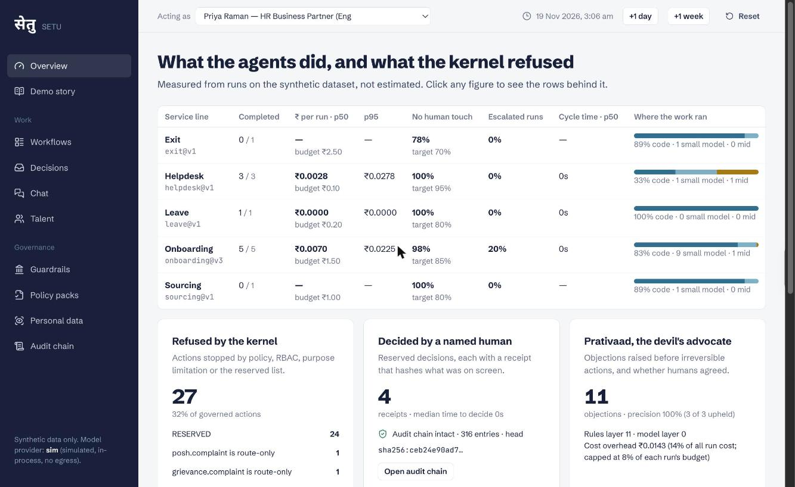
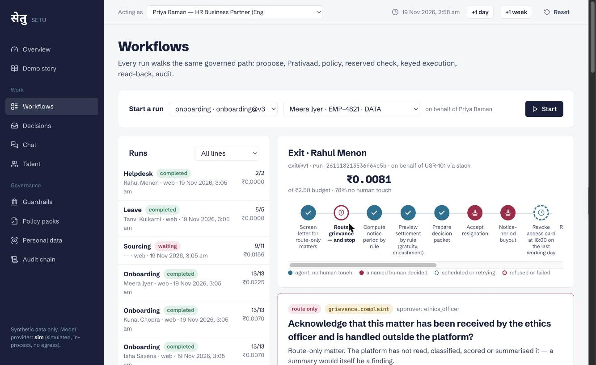
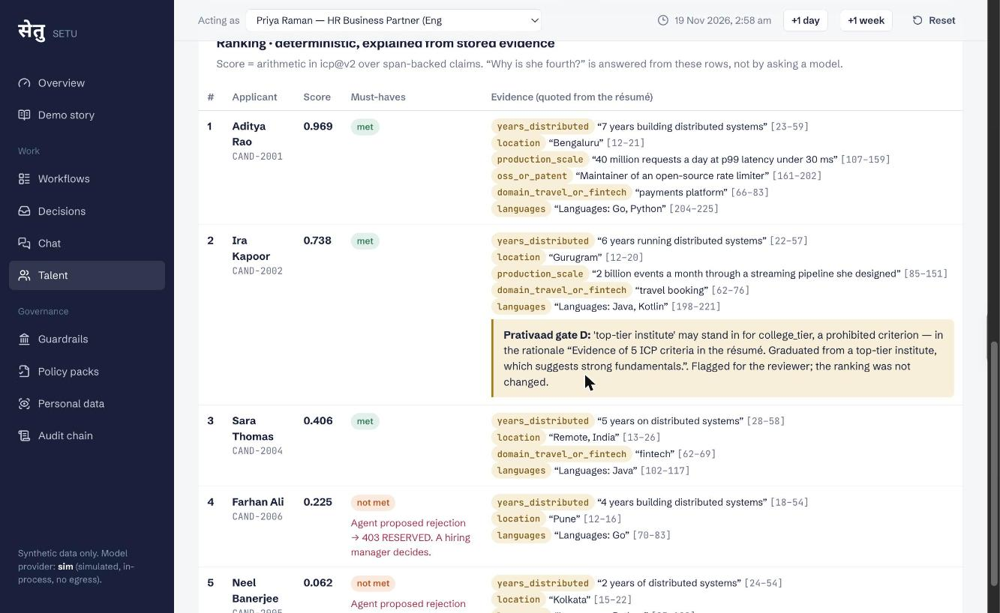

# SETU · सेतु

**An HR platform where the agents do the chasing, the kernel enforces the law, and you can prove what every workflow cost and who decided what.**

Built for *Building Software Faster — Challenge 2: an AI-native HR platform (TBO)*. Synthetic data only.



---

## Run it

```bash
make setup     # Python 3.12 venv + console dependencies
make up        # builds the console, seeds a synthetic dataset, serves everything on http://localhost:8000
```

or `make docker`. No API keys, no external services: the model provider defaults to an in-process simulated profile, so the demo is reproducible and nothing leaves the machine.

Open **Demo story** in the console and press the buttons in order — it plays one week at TBO on the real screens.

| Command | What it does |
|---|---|
| `make test` | 78 tests: policy packs, governance, golden runs, chaos, Hypothesis idempotency property, API contract, fault corpus |
| `./hrx validate` | Schema, load-time invariants and the governance lint (Prativaad gate C) |
| `./hrx test` | Replays synthetic runs under an injected retry storm; fails on any duplicate side effect |
| `make bench` | Every number in this README comes from here → [`bench/results/latest.md`](bench/results/latest.md) |
| `./hrx scaffold workflow <name>` | Starts a new service line without touching `core/` |

---

## What it is

Agents run routine HR work end to end. A governance kernel (**VIDHI**) sits between every agent intention and every real-world action. Humans own decisions with legal, financial or human consequences. A devil's-advocate layer (**PRATIVAAD**) attacks plans before anything irreversible happens. Every step is priced, logged and replayable.

```
 Experience   web console · chat (Slack-style) · dashboard          ── one intent API
 Agents       skills: manifest + handler — NO network egress        ── propose, never act
 VIDHI        orchestrator · policy decision point · reserved gate  ── the only path out
              idempotency/outbox · PII proxy · router + cost meter
              hash-linked audit · kill switch · Prativaad
 Data         system of record · policy packs · workflow defs · vault · connector SDK
 External     TBO mocks: ticketing · assets · access cards · directory · payroll · mail
```

**Every agent action walks the same path**, with no fast lane:

```
proposal → kill switch → Prativaad (irreversible only) → policy + RBAC ∩ capability ∩ step scope + DPDP purpose
         → reserved? → HOLD for a named human (receipt with a hash of what they saw)
         → else: outbox → connector (same idempotency key on every retry) → read-back verify → audit (₹, model, rules)
```



### Five service lines, one kernel

| Line | What runs | Reserved (human) decisions |
|---|---|---|
| **Onboarding** (`workflows/onboarding.v3.yaml`) | Entitlements by rule; IT ticket, laptop, access card, email, payroll (tokens only), welcome mail, induction | Band exception; ID check when the model is unsure |
| **Exit** (`workflows/exit.v1.yaml`) | Notice + settlement by rule; scheduled deprovisioning; retention clocks | Accept resignation (manager → HRBP), notice buyout, payroll sign-off; grievance lines route-only |
| **Leave** (`workflows/leave.v1.yaml`) | Booked by rule within policy | Manager beyond the auto limit; HR Head above balance |
| **Helpdesk** (`workflows/helpdesk.v1.yaml`) | Record lookups at tier 0; policy answers cite clause + pack version | — |
| **Talent / PARAKH** (`workflows/sourcing.v1.yaml`) | Lawful-basis gate, no-raid guard, span-backed claims, deterministic ICP score, gate-D bias flags | Campaign approval; rejection is reserved to the hiring manager |
| **Leave encashment** (`workflows/leave_encashment.v1.yaml`) | Added cold with `hrx` as the live-extension rehearsal | Finance sign-off above the pack's ₹50,000 threshold |

---

## Measured results

From `make bench` (one deterministic week on the synthetic dataset, simulated provider at a declared rate card, simulated approvers labelled in every receipt). Full report: [`bench/results/latest.md`](bench/results/latest.md).

| Line | Completed / runs | ₹/run p50 | ₹/run p95 | No human touch | Tier-0 steps |
|---|---|---|---|---|---|
| Onboarding | 9 / 9 | ₹0.0070 | ₹0.0225 | 98% | 83% |
| Exit | 8 / 8 | ₹0.0073 | ₹0.0081 | 81% | 93% |
| Leave | 40 / 40 | ₹0.0000 | ₹0.0000 | 90% | 100% |
| Helpdesk | 32 / 32 | ₹0.0024 | ₹0.0278 | 100% | 25% |
| Sourcing | 1 / 1 | ₹0.0156 | ₹0.0156 | 91% | 91% |

- **Prativaad fault corpus** (16 planted defects, 4 clean steps): the deterministic layer catches **88%** with **0 false alarms**. On the simulated provider the model layer adds **nothing**, and it costs 21% of run spend (it is capped at 8% of each run's *budget*). Measured, reported, and the model review was already shrunk once — from every irreversible step to once per run — when it measured 46%. See [docs/COST.md](docs/COST.md).
- **Projection** at assumed TBO volumes (placeholder until TBO shares figures): **≈ ₹6,510 / month**, almost all of it the assumed hosting cost; inference is a few rupees.
- Rupee figures are only as real as the rate card in `config/routing.yaml`. Point it at a real OpenAI-compatible endpoint and re-run `make bench`.

---

## How the brief's objectives are met

| # | Objective | Mechanism | Where to look | Proof |
|---|---|---|---|---|
| 1 | Automate end to end | Durable orchestrator, connectors, scheduled steps, fan-out | `core/orchestrator.py`, `workflows/` | Overview "no human touch", drillable to each human step |
| 2 | Platform, not point solution | Five extension points, `hrx`, load-time validation | `workflows/ skills/ connectors/ policies/` | Exit, PARAKH and leave-encashment commits touch no `core/` file (below) |
| 3 | Humans on decisions that matter | Reserved registry as config; `may_never` verbs fail at load; agents get 403 | `policies/reserved_decisions.v3.yaml`, `core/reserved.py` | Guardrails → Run the drill |
| 4 | Comply by design | Versioned packs with tests; refuse to load untested; gate B property testing | `policies/`, `core/rules/` | Policy packs → Draft a change → Ask Prativaad |
| 5 | Clean system of record | Employment spells, PII rows with purpose + retention, hash-linked audit | `core/sor.py`, `core/audit.py` | Audit chain → edit a row → verification breaks |
| 6 | Fail safely | Idempotency keys, outbox, read-back, breaker, saga, human queue with context | `core/executor.py` | Guardrails → break the asset system; tests/chaos |
| 7 | Serve people where they work | One intent API; rules-first intents; Slack-style surface | `core/intents.py` | Chat |
| 8 | Prove cost and impact | Per-call metering in ₹, p50/p95, bench | `core/router/`, `core/metrics.py`, `bench/` | `make bench` |

| Guardrail | Enforced by |
|---|---|
| No agent completes a reserved decision | Kernel classification before RBAC; verb allow-list checked at load and at run |
| POSH / grievance / whistleblower: route only | Deterministic lexicon routes; the packet says what the platform did *not* do; words visible only to the routed role |
| DPDP purpose, retention, access | Purpose tags on every PII row; retention clocks from the exit event with statutory holds cited; DSR access bundle |
| What personal data reaches a model | PII proxy: undeclared and prohibited fields stripped, names → `«PERSON_1»`, PAN/bank → vault placeholders. **Personal data** page shows the exact outbound payload per call |
| Fair hiring | Scores are arithmetic in `icp@v2`; claims need a verbatim span; `hire.reject_candidate` is reserved; gate D flags proxies |
| Labour law as rules | Notice, gratuity (5-year rule, 15/26, ceiling), encashment, EPF, F&F timelines in packs with tests. The simulated model's gratuity prose is deliberately wrong; the rule's number is the one that acts |
| Kill switch | Four scopes as table rows; paused runs park with context; automatic breaker on escalation rate |

---

## The extensibility claim, checkable from git

```bash
git log --oneline -- core/                       # every kernel change, each with its reason
git show --stat ccac514                          # PARAKH: workflows, skills, policies, connectors — no core/
git log --stat --format='%h %s' -- workflows/leave_encashment.v1.yaml
```

Two kernel additions were needed before PARAKH (fan-out steps and system-of-record operations for people who are not employees). They were made as separate `core:` commits *before* the line, and building it also surfaced one kernel bug (a crashing skill could stall a run), fixed in its own commit. All three are recorded in [PROGRESS.md](PROGRESS.md): a differently-shaped line is supposed to find gaps. The line itself, and leave encashment after it, land on extension points only. CI fails any PR labelled `service-line` that touches `core/` (`tools/ci/core_freeze.sh`).

[docs/DEVGUIDE.md](docs/DEVGUIDE.md) walks through adding leave encashment from zero.



---

## Repository layout

```
core/          VIDHI, the kernel. Frozen during service-line work.
workflows/     extension point 1 — declarative YAML
skills/        extension point 2 — manifest + handler (+ prompt, simulated responder)
connectors/    extension point 3 — SDK adapters; _spares/ pre-registered for the live test
policies/      extension point 4 — packs with tests; extension point 5 — reserved registry
mocks/         stand-ins for TBO's mock APIs, deliberately not idempotent, with chaos modes
apps/api       thin HTTP layer;  apps/web  the console (React + Vite)
tools/hrx      scaffold · validate · test;  tools/seed.py  synthetic data
tests/         policy · governance · workflows · chaos · property · contract · fault_corpus
bench/         make bench + the Prativaad fault corpus runner
docs/          DEVGUIDE · GOVERNANCE · COST · DEMO_SCRIPT
```

Design: [DESIGN.md](DESIGN.md) · plan: [PLAN.md](PLAN.md) · working rules: [CLAUDE.md](CLAUDE.md) · log: [PROGRESS.md](PROGRESS.md)

---

## What is simulated, said plainly

- **Model provider.** The default `sim` profile is a deterministic in-process stand-in per skill (`skills/*/simulated.py`), receiving the already-tokenised payload. Some behaviours are scripted to exercise defences (an invented patent claim, a college-tier phrase in a rationale, imprecise gratuity prose) and are documented in [docs/DEMO_SCRIPT.md](docs/DEMO_SCRIPT.md). `openai_compatible` is a configuration change.
- **TBO mock APIs.** TBO's starter kit was not available; `mocks/tbo.py` implements the systems the brief names. Connectors talk to them through a transport, so swapping in TBO's mocks is an adapter change.
- **Statutory values** marked *illustrative* in packs (state notice floors, retention periods) are placeholders for counsel. Gratuity and the F&F timeline follow the cited Acts.
- **Volumes** in the projection are assumptions (`config/costs.yaml`).
- **Login** is a demo "acting as" switcher, not an IdP.

---

## Licences

| Component | Licence |
|---|---|
| FastAPI, Pydantic, PyYAML, pytest, pip-licenses | MIT |
| Uvicorn, Starlette, httpx | BSD-3-Clause |
| Hypothesis (tests only) | MPL-2.0 |
| React, React DOM, Vite, @vitejs/plugin-react | MIT |
| TypeScript | Apache-2.0 |
| lucide-react (icons) | ISC |
| Schibsted Grotesk, JetBrains Mono, Noto Sans Devanagari (Google Fonts) | SIL OFL 1.1 |
| **Models** | None bundled. The `sim` profile is our own code. Any model configured under `openai_compatible` must carry a commercial-use licence (Apache-2.0 / MIT class). |

`make licenses` audits every installed Python package and fails on non-commercial licences; CI runs it on every push.

## AI coding assistant declaration

As the competition rules require: this repository was built with **Claude Code** (Anthropic's CLI agent, model Claude Opus 5.5). It wrote most of the kernel, service lines, console, tests, bench and documentation from the team's design documents (`DESIGN.md`, `PLAN.md`, `CLAUDE.md`), working in scoped commits. The team owns the design and is accountable for every line.

SETU's code is released under Apache-2.0.
