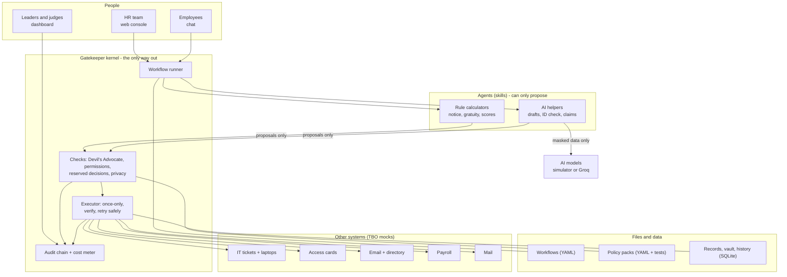
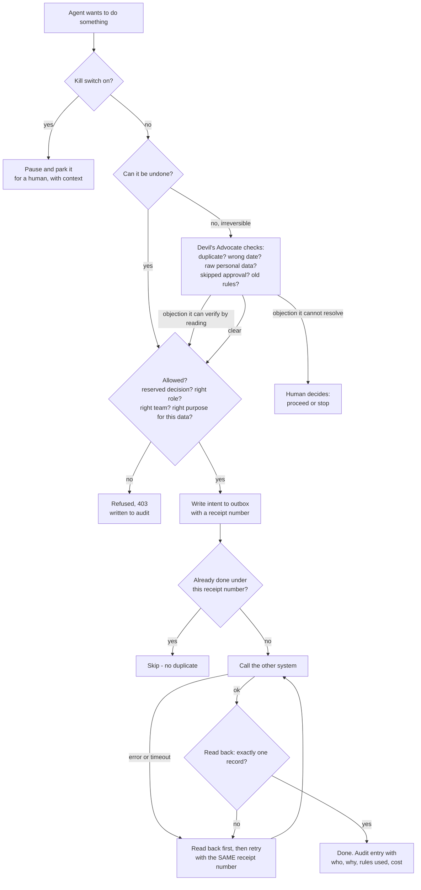
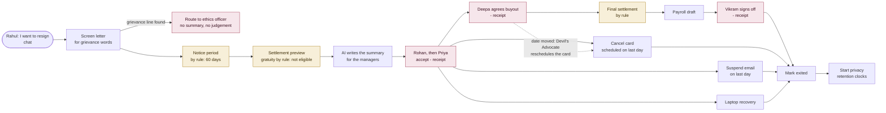
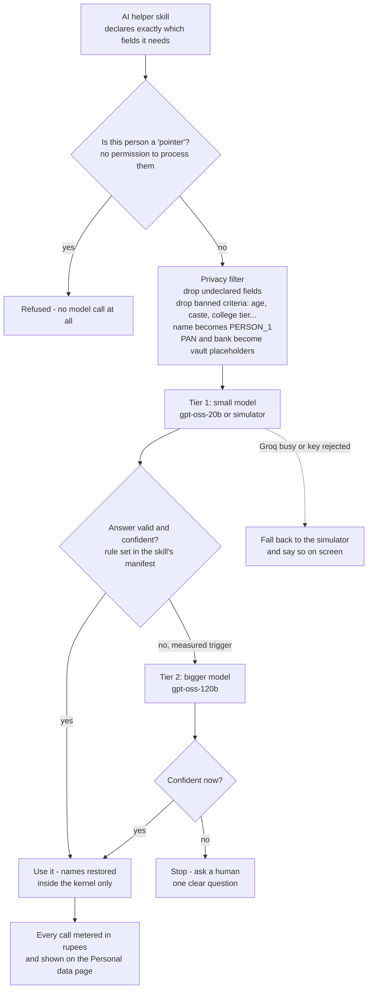
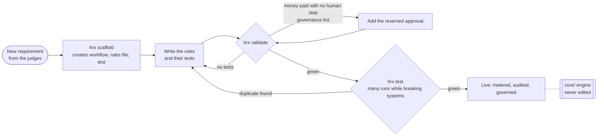
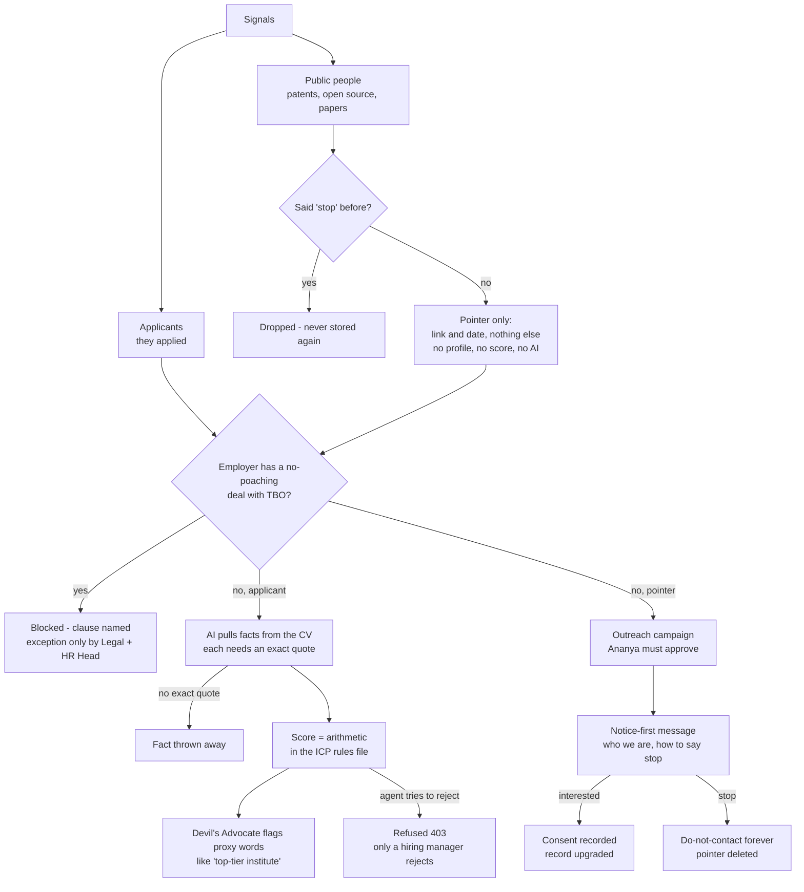

# HR Autopilot in six diagrams

Read them in order. Each one zooms into a part of the one before. Blue boxes are things the agents do; the kernel boxes are the strict checks; red/maroon is where a human decides.

---

## 1. The big picture: who talks to whom

Agents never touch the outside world. They ask the kernel, and only the kernel acts.

---

## 2. Every single action walks this path

Ordering a laptop, cancelling a card, booking leave: no exceptions, no shortcuts.

---

## 3. A workflow run, start to finish (Rahul resigns)

Steps run in order of their dependencies. The run pauses at human decisions and at future dates, then carries on.

Yellow = rules decide. Maroon = a named person decides. Everything else = the agent, through diagram 2.

---

## 4. What the AI is allowed to see, and how it is chosen

Personal data is masked before any model call. Cheap models first; a bigger one only on a measured reason.

---

## 5. Adding a new HR process without touching the engine

This is how the live test on finale day is answered.

The five things a developer can add: **workflow** (recipe), **policy pack** (rules), **reserved decision** (who must approve), **skill** (agent), **connector** (another system).

---

## 6. Finding talent fairly (FairHire)

Who may be scored, who is only a link, and who decides.

